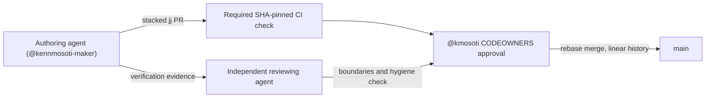

# Contributing to Metron

## Development loop

1. Read [AGENTS.md](AGENTS.md), the [architecture overview](docs/architecture/overview.md)
   and [knowledge index](knowledge/README.md).
   Inspect the working tree, issues and PR stack against the actual revision.
2. Choose a focused, independently verifiable change. Preserve product authority,
   persistence, replay and compatibility contracts, along with accepted ADRs.
   Agent and harness crates share the root workspace; keep their boundaries
   explicit and `metron-testkit` development-only.
3. Implement and verify each affected layer. Run the commands below and record
   their actual results, including failures and checks that could not run.
4. Update reader-facing contracts in `docs/`, architectural decisions through
   new ADRs, scientific priors in `docs/research/priors.md`, and dated supporting
   knowledge with provenance. Link related records.
5. Hand the PR stack to an independent reviewer to verify boundaries, tests,
   and commit hygiene before `@kmosoti` reviews and merges into `main`.

## Branches and review

`main` is the single protected integration and release branch. Native GitHub
branch rulesets require PRs, linear history (rebase merges only; no squash, no
force pushes, no branch deletion), passing `check` CI, resolved review threads,
and at least one approving code-owner review from `@kmosoti` via
[CODEOWNERS](.github/CODEOWNERS).

Agents contribute exclusively using the dedicated `@kennmosoti-maker`
Write-only (`push`, never admin) collaborator identity. Because `@kennmosoti-maker`
cannot push directly to `main` or satisfy `@kmosoti` code-owner approval, no
separate `develop` integration branch or `main-human-gate.yml` workflow
environment is needed.

An independent agent from an alternative model family (or fresh context at
medium reasoning) verifies boundaries, provenance, and commit hygiene before
requesting `@kmosoti` review. Use low or medium reasoning for routine
verification and review, with high reserved for complex work; max and ultra
reasoning are prohibited for verification and review. The author provides exact
verification evidence and fixes findings. `@kmosoti` performs human code-owner
approval and rebase-merges the stack bottom-up into `main`.

## Architecture diagrams for human review

Every PR submitted for human review must include or link a current architecture
diagram. This includes release PRs. Show the relevant components, dependency or
data-flow direction, and ownership or authority boundaries. Label proposed
components explicitly so reviewers can distinguish them from implemented ones.

Keep diagrams with their architectural contract or ADR and use Mermaid for
versioned diagrams rendered by GitHub. Update the diagram in the same PR when
architecture changes. For changes within existing boundaries, link the applicable
diagram and explain how the change fits it in the PR description. Reviewers check
that the diagram matches the source and proposed diff before human approval.

The [crate diagram](docs/architecture/overview.md#crates-and-the-direction-of-dependency)
shows implemented crate boundaries. The following diagram shows review and release
ownership for this workflow.



## Stacked changes

Use colocated Jujutsu (`jj`). Initialize an isolated worktree/clone and
configure commit messages once.

```sh
jj git init --colocate
jj bookmark track main@origin
git config commit.template .github/.gitmessage
```

Start the first layer on `main@origin` and place later layers above it.

```sh
jj git fetch
jj new main@origin -m 'feat(core): describe the focused change'
jj bookmark create stack/topic/01-core -r @
# Implement and verify the first layer before starting the next.
jj new -m 'feat(cli): expose the verified behavior'
jj bookmark create stack/topic/02-cli -r @
jj git push --bookmark stack/topic/01-core --bookmark stack/topic/02-cli
```

The first PR targets `main`. Each later PR targets its immediate predecessor
(`--base stack/topic/01-core`). Use [the PR template](.github/pull_request_template.md)
to list stack order and verification. Single changes use `<type>/<topic>`
bookmarks targeting `main`.

Edit an earlier layer with `jj edit stack/topic/01-core`. Jujutsu automatically
rebases its descendants. To move a stack onto updated `main@origin`, fetch then
run `jj rebase -s stack/topic/01-core -d main@origin`. Re-verify affected
layers and push all changed bookmarks.

Git 2.38+ is supported as a fallback. Branch from `origin/main`, create a branch
per layer, and use `git rebase --update-refs origin/main` from the top branch
when updating the stack. Push rewritten feature branches with `--force-with-lease`.
After landing the bottom PR, retarget the next PR to `main` and rebase only the
remaining commits onto `origin/main`. Re-verify affected behavior before
continuing. Protected `main` accepts only linear PR merges.

## Verification

The pinned toolchain is in [rust-toolchain.toml](rust-toolchain.toml). Run from the
root workspace before pushing.

```sh
cargo fmt --all --check
cargo clippy --workspace --all-targets -- -D warnings
cargo test --workspace
```

One workspace, lockfile and toolchain cover the product and development-only
testkit. CI runs the commands above for the full workspace. Physical sandbox and
CUDA checks are environment-specific evidence; do not present portable tests as
passing those gates. Alpha.1 remains incomplete until its independent coding and
resource acceptance criteria pass; see [D-0005](knowledge/decisions/D-0005-alpha1-delivery.md).

## Commits and knowledge

Use [the commit template](.github/.gitmessage). Keep atomic commits with a
`<type>(<scope>): <imperative summary>` subject under 72 characters, followed by
motivation, changes, exact verification, references and knowledge IDs. Supported
types are `feat`, `fix`, `refactor`, `test`, `docs`, `build`, `ci`, `proof`, `chore`.

Follow the [knowledge protocol](knowledge/README.md). Agent records can be used
immediately with `human_ratified: false`. Explicit human confirmation is required
to mark a record ratified. PR merge alone does not ratify its claims.

Contributions use the repository's [Apache-2.0 license](LICENSE).
