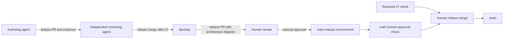

# Contributing to Metron

## Development loop

1. Read [AGENTS.md](AGENTS.md), the [architecture overview](docs/architecture/overview.md),
   [invariants](docs/architecture/invariants.md) and [knowledge index](knowledge/README.md).
   Inspect the working tree, issues and PR stack against the actual revision.
2. Choose a focused, independently verifiable change. Preserve the four laboratory
   invariants and existing accepted ADRs. Product work follows the runtime
   proposal's P0 compatibility decision.
3. Implement and verify each affected layer. Run the commands below and record
   their actual results, including failures and checks that could not run.
4. Update reader-facing contracts in `docs/`, architectural decisions through
   new ADRs, scientific priors in `docs/research/priors.md`, and dated supporting
   knowledge with provenance. Link related records.
5. Hand the PR or stack to an independent reviewer who owns landing into `develop`.
   Promote `develop` to `main` through human review at release checkpoints.

## Branches and review

`develop` is the agent integration branch. `main` is the human-gated release branch.
Both require PRs, linear history, successful `check` CI and resolved conversations.
Only rebase merging is enabled. Force pushes and deletion of these branches are
blocked, including for administrators.

An independent agent from an alternative model family reviews each integration
change. If unavailable, use a fresh independent agent at medium reasoning. Use
low or medium reasoning for routine verification and review, with high reserved
for complex work. Max and ultra reasoning are prohibited for verification and
review. The author provides exact verification evidence and fixes findings. The reviewer verifies
boundaries, provenance and commit hygiene, then lands the stack bottom-up with
`gh pr merge <number> --rebase --delete-branch`. GitHub requires zero approving
reviews on `develop` so a reviewer using the author's account can land changes.
Independent agent review is an operating agreement enforced by contributors.

A release PR goes from `develop` into `main`. A human reviews it, manually approves
`main-human-approval` through the `main-release` GitHub Environment, and rebase
merges it. Agents must never approve the environment, bypass its protection or
merge into `main`. The environment requires `kmosoti` and disables administrator
bypass. GitHub credentials shared with a human do not distinguish agent actions,
so the prohibition on agent approval remains part of [AGENTS.md](AGENTS.md).

## Architecture diagrams for human review

Every PR submitted for human review must include or link a current architecture
diagram. This includes release PRs. Show the relevant components, dependency or
data-flow direction, and ownership or authority boundaries. Label proposed
components explicitly so reviewers can distinguish them from implemented ones.

Keep diagrams with their architectural contract or ADR and use Mermaid for
versioned diagrams rendered by GitHub. Update the diagram in the same PR when
architecture changes. For changes within existing boundaries, link the applicable
diagram and explain how the change fits it in the PR description. Reviewers check
that the diagram matches the source and proposed diff before human approval.

The [laboratory crate diagram](docs/architecture/overview.md#crates-and-the-direction-of-dependency)
shows implemented crate boundaries. The following diagram shows review and release
ownership for this workflow.



## Stacked changes

Prefer colocated Jujutsu. Initialize a clone and configure commit messages once.

```sh
jj git init --colocate
jj bookmark track develop@origin main@origin
git config commit.template .github/.gitmessage
```

Start the first layer on `develop@origin` and place later layers above it.

```sh
jj git fetch
jj new develop@origin -m 'feat(core): describe the focused change'
jj bookmark create stack/topic/01-core -r @
# Implement and verify the first layer before starting the next.
jj new -m 'feat(cli): expose the verified behavior'
jj bookmark create stack/topic/02-cli -r @
jj git push --bookmark stack/topic/01-core --bookmark stack/topic/02-cli
```

The first PR targets `develop`. Each later PR targets its immediate predecessor.
Use [the PR template](.github/pull_request_template.md) to list stack order and
verification. Single changes use `<type>/<topic>` branches targeting `develop`.

Edit an earlier layer with `jj edit stack/topic/01-core`. Jujutsu rebases its
descendants. To move a stack onto current integration work, fetch then run
`jj rebase -s stack/topic/01-core -d develop@origin`. Verify affected layers and
push all changed bookmarks.

Git 2.38+ is supported as a fallback. Branch from `origin/develop`, create a branch
per layer, and use `git rebase --update-refs origin/develop` from the top branch
when updating the stack. Push rewritten feature branches with `--force-with-lease`.
After landing the bottom PR, retarget the next PR to `develop` and rebase only the
remaining commits onto the new `origin/develop`. Re-verify affected behavior before
continuing. Protected integration and release branches accept PR merges.

## Verification

The pinned toolchain is in [rust-toolchain.toml](rust-toolchain.toml). Run from the
root workspace before pushing.

```sh
cargo fmt --all --check
cargo clippy --workspace --all-targets -- -D warnings
cargo test --workspace
cargo run -p metron-cli -- run experiments/manifests/smoke-majority3.json --results target/results
cargo run -p metron-cli -- run experiments/manifests/smoke-majority3-capped.json --results target/results
for journal in target/results/*/episode.jsonl; do
  cargo run -p metron-cli -- verify "$journal"
done
```

CI runs these same checks. Future separate workspaces need their own explicit CI
coverage and dependency-boundary checks when introduced. Reproducible outcomes
control the [milestones](docs/architecture/milestones.md).

## Commits and knowledge

Use [the commit template](.github/.gitmessage). Keep atomic commits with a
`<type>(<scope>): <imperative summary>` subject under 72 characters, followed by
motivation, changes, exact verification, references and knowledge IDs. Supported
types are `feat`, `fix`, `refactor`, `test`, `docs`, `build`, `ci`, `proof`, `chore`.

Follow the [knowledge protocol](knowledge/README.md). Agent records can be used
immediately with `human_ratified: false`. Explicit human confirmation is required
to mark a record ratified. PR merge alone does not ratify its claims.

Contributions use the repository's [Apache-2.0 license](LICENSE).
