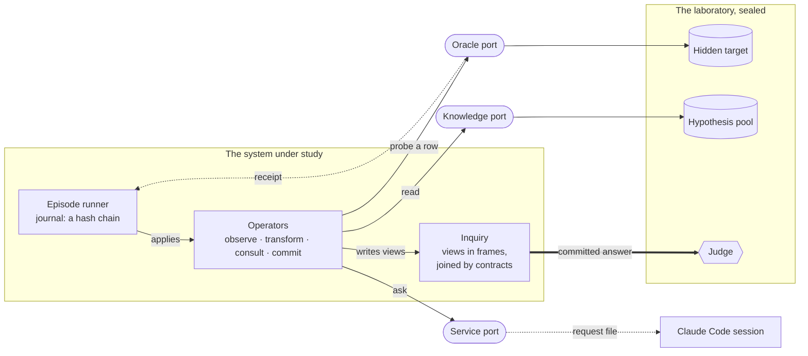
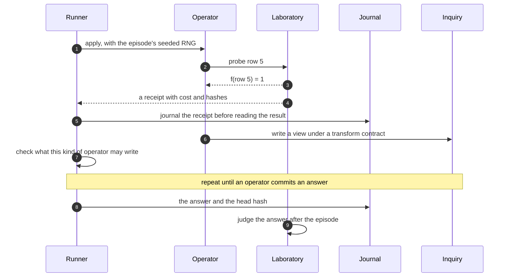
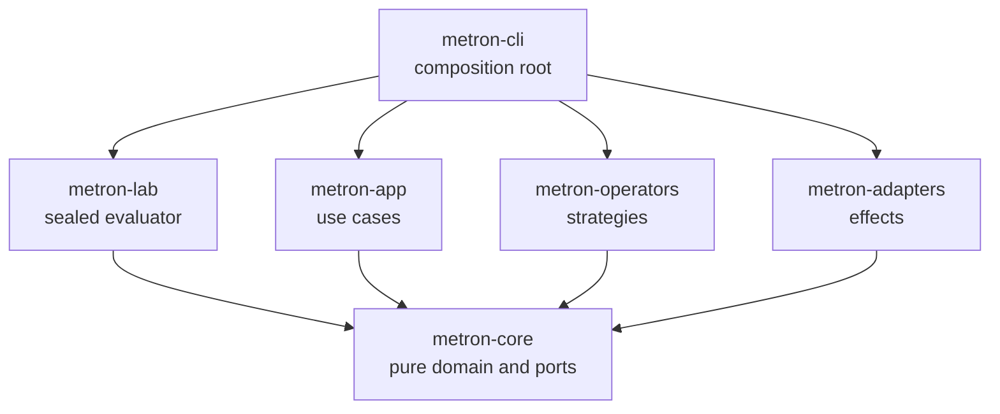

# Metron

**Hexagonal Cognitive Kernel: a laboratory where a resource-bounded system
learns hidden Boolean functions through several representations, and where
every claim has to survive measurement.**

[](https://github.com/kmosoti/Metron/actions/workflows/ci.yml)

The proposed next direction is a Rust-native agent and execution harness with
independent library boundaries and pure decision logic. The
[runtime research and implementation sequence](knowledge/research/README.md)
records the source evidence, proposed contracts and staged acceptance criteria.
[Issue #7](https://github.com/kmosoti/Metron/issues/7) tracks implementation.
The implemented system described below is the research laboratory.

The system never sees the function it is trying to learn. It asks questions
through a port, pays for every answer with a receipt, and commits a guess
that the laboratory judges once the episode is over. These rules are not a
convention: the build fails if any of them is broken.

## The picture



Four rules hold everywhere, and `cargo test` checks them on every build: the
core is pure, the laboratory owns ground truth, every external operation
leaves a receipt, and representations meet only through explicit transform
contracts that say what they preserve, lose and assume.

## One episode



The same manifest and seed always produce the same journal head, so any run
can be replayed and audited, including runs that paused to ask a language
model a question.

## Research findings

The [laboratory results and milestone snapshot](knowledge/observations/O-0002-laboratory-results-snapshot.md)
collects the measured routing, retrieval and promotion findings, their figures,
and the laboratory's outcome milestones. Supporting reports and accepted decisions
are linked there.

## Explore



| If you want to… | Go to |
|---|---|
| see the rules the build enforces | [docs/architecture/invariants.md](docs/architecture/invariants.md) |
| follow an episode end to end, crate by crate | [docs/architecture/overview.md](docs/architecture/overview.md) |
| read the milestones and their exit criteria | [docs/architecture/milestones.md](docs/architecture/milestones.md) |
| know why things are the way they are | [docs/adr](docs/adr/README.md) |
| check what was assumed and what survived | [docs/research/priors.md](docs/research/priors.md) |
| open the raw measurements | [experiments/reports](experiments/reports/README.md) |
| run experiments, or answer a consultation as the language model | [experiments/README.md](experiments/README.md) |
| follow the development and review workflow | [CONTRIBUTING.md](CONTRIBUTING.md) |
| find dated decisions, research and observations | [knowledge/README.md](knowledge/README.md) |
| change the code, as a person or a coding agent | [AGENTS.md](AGENTS.md) |

```sh
cargo test --workspace                                                    # the rules, as tests
cargo run -p metron-cli -- run experiments/manifests/smoke-majority3.json # one episode
cargo run --release -p metron-cli -- headroom experiments/manifests/headroom-arity5.json
cargo run -p metron-cli -- figures                                        # refresh laboratory figures
```

Apache-2.0. See [LICENSE](LICENSE).
