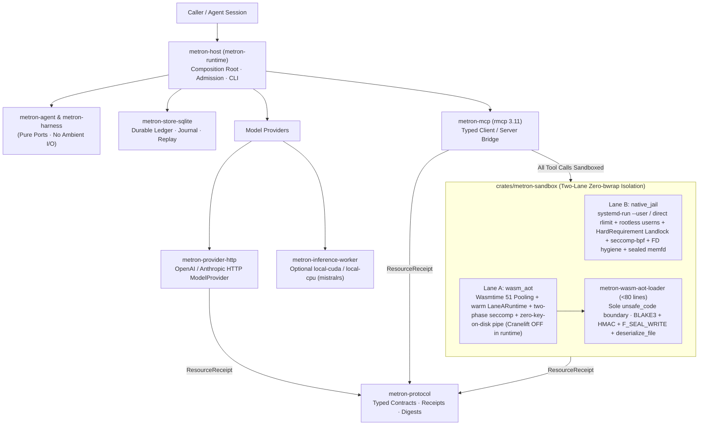

# Metron

Metron is a Rust-native agent and execution harness built around explicit
authority transitions, two-lane zero-bubblewrap kernel/WebAssembly sandboxing,
cryptographic `ResourceReceipt` accounting, and durable SQLite replay.

[](https://github.com/kmosoti/Metron/actions/workflows/ci.yml)

## Architecture



### Workspace Crates

| Crate | Role | `unsafe_code` | Notes |
|---|---|---|---|
| [`metron-protocol`](crates/metron-protocol) | Versioned envelopes, digests, receipts, coding contracts | Forbidden | Pure; no ambient I/O |
| [`metron-agent`](crates/metron-agent) | Agent coordination state machine and proposals | Forbidden | Pure; no ambient I/O |
| [`metron-harness`](crates/metron-harness) | Bounded admission, audit replay, effect driver port | Forbidden | Pure; no ambient I/O |
| [`metron-store-sqlite`](crates/metron-store-sqlite) | Atomic SQLite inbox, indexed `intents(task_id, status)`, external receipts | Forbidden | Explicit transaction boundary |
| [`metron-sandbox`](crates/metron-sandbox) | Lane B (`native_jail`) + Lane A (`wasm_aot` Pooling) + jailed split compiler | Forbidden | Zero `bwrap`, strict Landlock, rootless userns, direct `rlimit` |
| [`metron-wasm-aot-loader`](crates/metron-wasm-aot-loader) | Sealed `memfd` + streaming BLAKE3 + HMAC check before `Component::deserialize_file` | Audited (`< 80` lines) | Sole `unsafe_code` exception |
| [`metron-mcp`](crates/metron-mcp) | `rmcp 3.11` typed bridge with schema validation, cancellation & `SqliteReceiptSink` | Forbidden | Routes all tools via `metron-sandbox`, bounded receipt ring |
| [`metron-provider-http`](crates/metron-provider-http) | Pluggable HTTP `ModelProvider` (tools, JSON schema, caching, pricing, SSE, retries/CB) | Forbidden | Redirect-disabled, redacted errors with failure receipts |
| [`metron-host`](crates/metron-host) | Composition root CLI (`metron-runtime`), `ModelBackend::Http` & `McpToolDispatcher` | Forbidden | Wires ports, `LaneAWasm`, MCP, and SQLite receipt persistence |
| [`metron-inference-local`](crates/metron-inference-local) | Worker framing, artifacts, fit bounds, resource supervision | Forbidden | SDK-free adapter |
| [`metron-inference-worker`](crates/metron-inference-worker) | Optional local `mistralrs` stdio worker | Forbidden | `mistralrs` gated on `local-cuda` / `local-cpu` |
| [`metron-testkit`](crates/metron-testkit) | Controlled test fixtures and recorded replies | Forbidden | Dev-only; enforced by `tests/architecture` |

See [docs/architecture/overview.md](docs/architecture/overview.md),
[ADR 0029](docs/adr/0029-wasmtime-aot-landlock-seccomp-sandbox.md), and
[ADR 0030](docs/adr/0030-model-provider-and-rmcp-boundary.md) for detailed design decisions.

## Standalone Quickstart

### Prerequisites

- **Rust `1.100.0`** (pinned via `rust-toolchain.toml`, Edition `2024`)
- **Linux kernel** with `memfd_create` seals, `seccomp-bpf`, and Landlock (`ABI v3..v6`)
- Optional: `systemd --user` cgroup v2 delegation (`systemd-run --user --collect`) for Lane B / Lane A transient cgroup limits

### Build & Verify Without GPU

Default builds keep `mistralrs` disabled and Cranelift out of runtime binaries:

```sh
cargo fmt --all --check
cargo clippy --workspace --all-targets --locked -- -D warnings
cargo test --workspace --locked
```

### Build the Split Offline Wasm AOT Compiler

Compile `.wasm` / `.wat` components into HMAC/BLAKE3-sealed `.cwasm` artifacts separately from the runtime host:

```sh
cargo build --locked -p metron-sandbox --features compiler --bin metron-wasm-compiler
METRON_AOT_HMAC_KEY="<64-hex-key>" ./target/debug/metron-wasm-compiler input.wat out.cwasm out.seal.json
```

### Run Local `mistralrs` Worker (Optional)

Enable `--features local-cuda` on CUDA workstations (or `--features local-cpu` on CPU hosts):

```sh
cargo build --locked -p metron-inference-worker --features local-cuda
```

### Run Selected Standalone Tests

```sh
# Lane A (Wasmtime 51 AOT + Landlock + post-load PROT_EXEC seccomp) & Lane B kernel negative controls
cargo test --locked -p metron-sandbox

# Architecture boundaries (<80-line loader pin, zero Cranelift in runtime, optional mistralrs)
cargo test --locked -p metron-architecture-tests

# HTTP ModelProvider & rmcp 3.11 sandbox bridge
cargo test --locked -p metron-provider-http -p metron-mcp
```

## Documentation, Releases & Contribution

- [v0.1.0-alpha.1 Release Notes](docs/releases/v0.1.0-alpha.1.md)
- [Agent and Harness Usage](docs/agent-harness.md) · [Bounded Coding](docs/coding.md)
- [CONTRIBUTING.md](CONTRIBUTING.md) · [AGENTS.md](AGENTS.md) · [Knowledge Index](knowledge/README.md)

Alpha.1 acceptance criteria are tracked in [Issue #7](https://github.com/kmosoti/Metron/issues/7).
Historical Boolean-laboratory material remains archived in
[knowledge/archive/laboratory/](knowledge/archive/laboratory/README.md) and is excluded from product builds.
