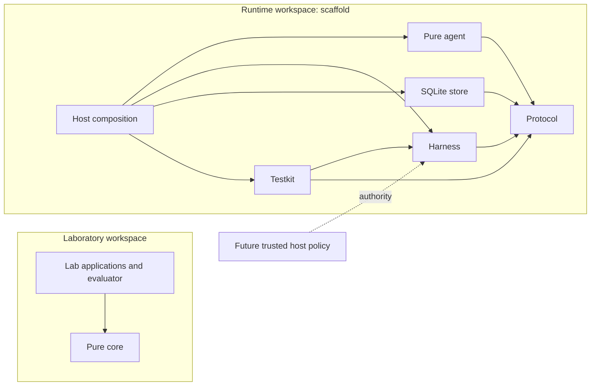

# 0019 — Runtime workspace compatibility

Status: accepted (agent-authored; human ratification pending)

## Context and decision

The laboratory and the proposed runtime have distinct trust and dependency
boundaries. The runtime is a nested Cargo workspace at `products/runtime`, with
its own lockfile. Neither workspace depends on the other. The laboratory retains
its existing crate membership, evaluation behavior and accepted decisions.

Both workspaces use edition 2024, declare Rust 1.100 as their minimum and pin
`beta-2026-11-07` (rustc 1.100.0-beta.12). The dated beta is deliberate: a
floating beta can change compiler versions. Stable 1.100 requires a separate
qualification before changing the pin. First-party Rust forbids unsafe code.
CI's required `check` job verifies formatting, clippy and tests for both
workspaces and retains the laboratory smoke and journal verification commands.

Arrows show intended dependency direction, not implemented product behavior.
The runtime starts with only the seven scaffold crates; no integration bridge is
introduced. Architecture tests check workspace membership and dependency
boundaries. Product behavior remains subject to its subsequent contracts.

## Alpha.0 contract refinements

The alpha.0 driver and store ports are synchronous and bounded; earlier async
sketches are not the alpha.0 interface. Elapsed-time budget requests are
unsupported. Accounting posts a full representable usage vector once, including
an overrun; if any component cannot be represented, it posts none, preserves the
exact vector as an unposted debit, holds reservations, and blocks affected
accounts. Unknown usage likewise retains reservations. These are target
semantics, not claims of implementation in this scaffold.

## Consequences

The dated beta is a prerelease dependency for both workspaces and must be
available wherever builds run. Separate locks and CI coverage make product
changes independently visible while preserving the laboratory's evaluator and
fixtures. Revisit the pin after stable 1.100 qualification or if reproducibility
or compatibility evidence changes.
