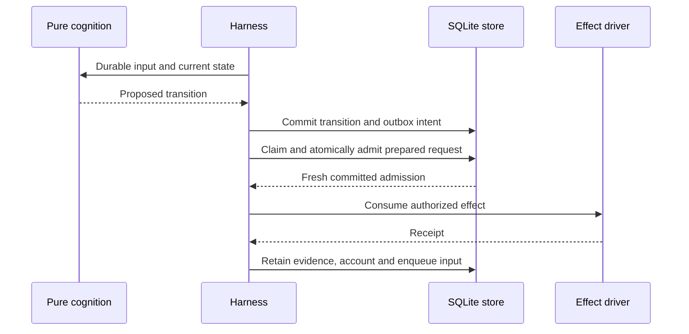

# 0020 — Durable bounded runtime execution

Status: accepted (agent-authored; human ratification pending)

## Context

The isolated runtime needs an executable boundary between pure cognition and
effects, including recovery when a process dies between admission and a receipt.
This decision refines the alpha.0 targets in ADR 0019 without changing laboratory
contracts or its inference bridge.

## Decision

Use synchronous, bounded ports for the scripted alpha.0 workload. Cognition
returns typed transitions. The harness materializes and checks requests; SQLite
atomically admits an effect, reserves task and principal budgets, and journals
the result. Only an unambiguous fresh admission acknowledgment can mint the
private, consumed Rust execution token. A duplicate acknowledgment grants no
execution authority.

The versioned journal uses canonical typed events and framed SHA-256 bindings.
Every newly committed command, including a semantic no-op, records its command
and result. Reusing the same command ID returns the frozen result without a new
event; a different payload under that ID fails integrity validation. Persisted
inbox inputs are consumed with their complete transitions.

Representable actual usage posts the entire vector once. Usage beyond the
reservation or budget marks both accounts breached. If any component cannot be
represented, none of the vector posts: the exact decimal vector remains an
unposted debit, reservations remain held, and affected accounts are incomplete.
Unknown usage also retains reservations. Later receipts cannot silently repair
unknown or unposted usage.

Leases and approvals use an explicitly advanced logical clock. Opening a run
does not advance time or recover effects. A dispatched effect with unknown
completion is not automatically repeated. Publication uses a persisted fixed
plan, synced files and a no-replace hard link. Explicit reconciliation may select
compatible known evidence or establish the planned publication from its exact
artifact; unresolved usage and multiple distinct evidence records remain blocked.

Read-only audit independently reconstructs accounting and projections from the
journal and reruns consumed cognition inputs. Artifact verification separately
parses the fixture, recomputes the answer and checks published bytes. Audit pages
are limited to 16 records and 1 MiB; alpha.0 supports at most 4,096 journal records
and 8 MiB of cumulative journal bytes per audit. Larger valid histories return
an operational error and remain intact.

## Consequences and limits

The runtime has explicit recovery and accounting states rather than an exactly
once external-effect promise. SQLite transactions do not span driver execution.
The local run directory and filesystem semantics are trusted; Rust token privacy
does not provide an operating-system sandbox. Process-kill tests establish only
their tested checkpoint behavior, not arbitrary power-loss durability.

Alpha.0 has no live model, shell, network or general workspace tools. Local
mistral.rs inference, model memory admission, batching and cache policies remain
alpha.1 work. The dated Rust 1.100 preview pin remains governed by ADR 0019.

Revisit when adding providers, changing persistent formats or tariffs, extending
automatic reconciliation, or raising audit capacity.
