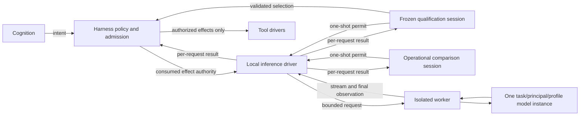

# 0021 — Bounded native local inference

Status: accepted (agent-authored; human ratification pending)

## Context

The separate runtime needs a local model execution boundary with explicit identity,
admission and accounting. This decision does not change the laboratory's Claude
Code inference bridge in ADR 0009. The published mistral.rs 0.9.5 release predates
LFM3 support; the runtime pins source revision
`fb4cdc3730dc64b366724e7637a205a8b7747499` instead.

## Decision

Run the native LFM3 worker as an isolated child process, with optional CUDA. A
worker owns one loaded model for a task, principal and effective profile. The
Reasoner role returns text; ToolSelector returns a closed tool proposal that is
subject to the harness's independent authority checks. Both roles share weights;
each request retains its own dispatch identity, admission and receipt.

Use the pinned official GGUF and auxiliary files, verified by full size and
SHA-256 before loading. The embedded GGUF tokenizer and pinned template define
input rendering. Local decoded context is bounded to 64 KiB and request frames to
512 KiB; reply frames remain 64 KiB. Existing v1 task context remains 4 KiB, and
existing output and receipt bounds are unchanged. The model checks actual rendered
tokens against the profile's input and reserved output budget. The comparison
baseline has 8,192 context tokens and disables thinking, prefix caching, paged
attention and CUDA graphs.

The harness records durable admission before execution. Known observations and
rejections produce individually bound receipts; an unknown outcome blocks the
session without an automatic retry or fabricated zero usage. Streaming output is
bound to the final observation; the selector is usable only when its final closed
proposal validates.

The host owns private operational report types and serializes them with Serde.
The inference SDK remains confined to the worker; pure-crate dependency rules are
unchanged. Report files confer no execution or qualification authority.

Frozen-corpus production qualification and operational comparison are separate
paths. Comparisons use a bounded model-only authority and cannot create production
qualification or promote a profile. The fixed Q4/Q6/Q8 comparison includes short
and near-8K cases, three repetitions and concurrency 1, 2, 4 and 8. A selectable
candidate requires concurrency of at least 2, correctness, p95 usable latency
strictly below one second for both roles and context sizes, process GPU memory at
most 4 GiB, and at least 1 GiB free GPU memory. No candidate is a valid outcome.

## Consequences

Offline execution requires all pinned inputs and a compatible compiled worker.
Build-time host RAM and inference-time VRAM have separate limits. A model or
backend change requires new evidence; the first GPU execution is feasibility
evidence, not qualification or a latency claim. See
[R-0010](../../knowledge/research/R-0010-lfm3-native-inference.md).
