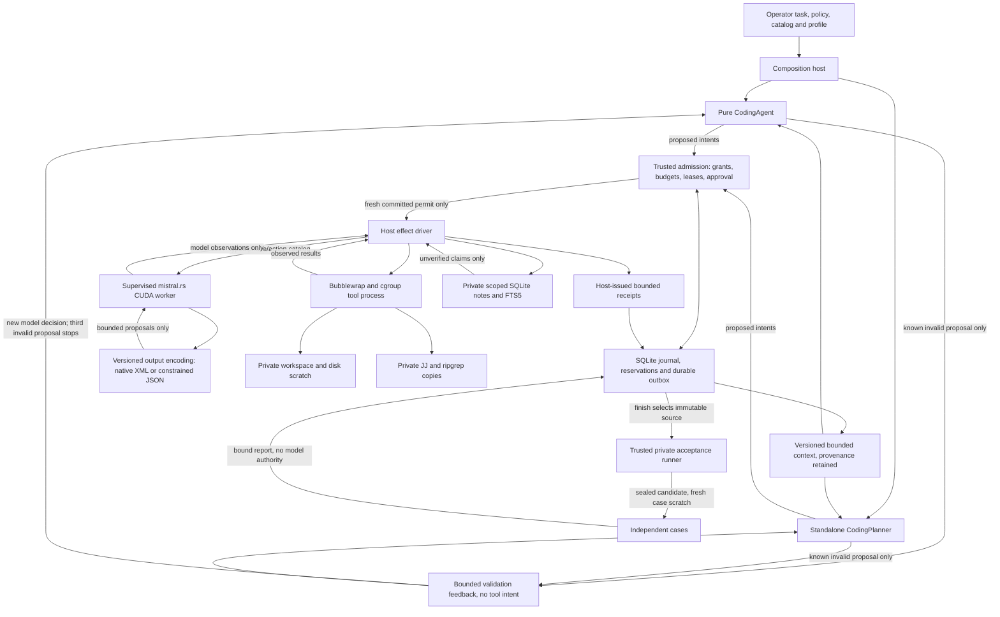

# 0022 — Explicit coding contracts and scoped cross-task memory

Status: proposed (agent-authored; human ratification pending)

## Context

Alpha.0 implements one sum fixture, independently of its descriptive objective.
A calculator objective submitted to that family produced a valid sum artifact,
not a calculator. Native CUDA generation is established separately in O-0005;
its operational comparison failed entry and selected no production profile.

Alpha.1 must connect task purpose, effects, artifacts and independent acceptance.
Cross-task memory is included in this release's scope; the remaining autonomous
agent lifecycle stays alpha.2. This decision extends ADRs 0019–0021 without
altering their accepted laboratory or legacy replay contracts.

## Decision

New submissions select their task family explicitly. Missing or unsupported
families reject before run creation or model loading. Legacy fixture runs use
`--task-family sum-v1`; their verifier certifies only that fixture. Persisted
v1/v2 runs continue to resume/replay without changing serialized identities.

Coding uses a separate version-3 task envelope binding principal, project,
objective, tool catalog, model profile, memory collection and operator-owned
acceptance digest. Typed actions are proposals, never capabilities. A finish
proposal requests independent acceptance of immutable final source artifacts;
neither model assertions nor candidate-written tests can set the verdict.

The following diagram shows the implemented experimental boundary. Native coding
acceptance and resource qualification remain release gates, not consequences of
wiring these components.

Use Fedora bubblewrap namespaces and cgroup-v2 process/resource controls for
real effects. Bind only required tools, an isolated workspace and private SSD
scratch; deny ambient credentials and network. Path validation supplements
directory-capability operations and OS confinement. No unsandboxed fallback.
Interrupted process trees must be terminated or explicitly remain uncertain.

Statically wire workspace, jj, ripgrep, Rust, Z3 and Lean adapters behind the
normal admission/receipt path. No alpha.3 registry is required. jj snapshots are
mutations, including automatic snapshots during ordinary inspection. Confine
runtime Git/jj metadata to independent task repositories. SMT/Lean results are
scoped to their statements and assumptions, not global software certificates.

Cross-task memory uses canonical SQLite records plus a rebuildable FTS5 index.
Host grants scope every query/mutation to principal, project and collection.
Store immutable provenance, distinguish unverified claims from evidence, retain
contradictions and identify stale sources. Model text cannot promote itself to
trusted evidence. Private evaluator material is excluded from memory/context.
Memory mutations use durable identities and receipts; retrieval results and
context manifests are recorded so replay does not rerun retrieval.

Controller versions define prompt bytes explicitly. Do not let dependency
feature unification change object ordering or input digests. Earlier versions
retain their serialization contract. Compact model views preserve full evidence
hashes in state while displaying bounded observations and complete CAS file
references. Model-authored plans and retrieved text remain data.

Static planner/coder/reviewer personas affect context and suggested behavior,
never principals or authority. No autonomous goals, wakeup scheduler, delegation,
MCP, browser or desktop adapter is added under this release.

## Consequences and release gates

The independent agent and harness libraries remain separated by protocol ports;
all I/O and process/model dependencies stay at effect/composition boundaries.

The native coding recipe uses SDK function metadata from the admitted phase and
policy catalog. Its v3.4 model step carries that catalog as typed data. Raw
function calls are retained with their normalized proposals and actual usage;
the worker never executes a returned function. The inference adapter may depend
directly on `serde_json` for bounded model-artifact transformation; the SDK stays
confined to the worker crate.

LFM3's GGUF converter in the pinned SDK misclassifies its user-defined XML
tokens as special. A versioned compatibility tokenizer corrects those 14 flags,
preserves every GGUF vocabulary ID and merge, and retains the converter's other
settings. The profile binds the transform and source identities, while the worker
logs the materialized file hash and the SDK validates every ID before loading.
See [O-0008](../../knowledge/observations/O-0008-coding-loop-and-confinement.md)
for the reproduced failure and matched native probe.
Keep Rust 1.100's dated toolchain pin and existing laboratory golden journals.

LFM3-1.7B Q4_K_M stays the local iteration backend. Reuse the verified CUDA build
and full artifact identities; do not silently substitute a hosted service.
Version changed prompts/constraints/corpora without rewriting failed evidence.
Qualify batching, hybrid cache state and resource envelopes under R-0008/R-0009.
Sampled telemetry is not a hard allocator cap. Compilation and inference have
separate resource budgets; build scratch/targets stay on SSD.

Release requires controlled harness proofs and actual LFM3 CUDA coding through
Metron: an empty-workspace checked-i64 calculator and a frozen Rust repair task,
with independent acceptance. A coordinating agent must not supply the calculator
implementation. All mandatory confinement, recovery, memory, inference and
efficiency gates must have passing evidence. Failures keep issue #7 open.

See D-0005 for the implementation/evidence matrix and R-0011 for tool sources.
