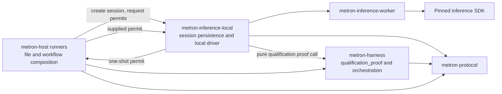

# 0025. File-backed inference session authority belongs to the local adapter

- Status: proposed
- Date: 2026-11-12
- Deciders: Metron maintainers
- Supersedes: none

## Context

Operational comparison and frozen-corpus qualification require durable,
file-backed session state. Each session bounds the requests it may issue,
records admission before authorizing inference, and validates the observations
returned by the worker. Qualification also enforces its calibration/warmup and
held-out ordering. These responsibilities require local persistence and sit
beside the adapter that owns local inference requests and worker lifecycle.

The harness remains responsible for pure orchestration and independent
qualification proof. Its `qualification_proof` module checks frozen reports
and derives proof records without file or process I/O. The host runners compose
profile/corpus files, session creation, the worker driver and output reports.

## Decision

Place the file-backed `comparison` and `qualification` session APIs in
`metron-inference-local`. These APIs own session journals, admission
state-machines and issuance of one-shot `ComparisonPermit` and
`QualificationPermit` values. Keep pure report validation and calibration
proof construction in `metron-harness::qualification_proof`; keep concrete
file access and workflow composition in the host's comparison and qualification
runners.

Preserve the session contract: permit constructors remain private, permits are
neither cloneable nor deserializable, and the session appends and syncs each
admission record before returning permits. Existing bounded-session,
warmup/closed/cancellation, and unknown-outcome behavior remains in force. A
failed or interrupted session cannot silently reissue the same authority. The
four compile-fail tests for permit construction and duplication remain part of
the contract.

This is an internal Rust ownership and dependency boundary within the same
process. It is not an OS sandbox, privilege boundary, or trust-isolation
mechanism. Moving the modules changes their Rust import paths and consumer
imports intentionally. It changes no serialized permit, protocol schema,
store operation, session journal format, or authority semantics, and requires
no journal migration.

The source move is behavior-preserving: comparison against the prior product
tree found only import-path changes in the moved session modules. The moved
logic retains durable-before-issue ordering and all four permit
non-forgeability compile-fail checks.

## Consequences

- `metron-inference-local` owns file-backed comparison and qualification
  session state next to local inference adaptation.
- Host runners remain responsible for selecting inputs and composing session,
  driver and report operations; the local crate does not become a CLI or
  application workflow owner.
- `metron-harness` can retain pure admission/orchestration contracts and the
  qualification proof without owning ambient filesystem access.
- Consumers importing these session APIs use the `metron-inference-local`
  module paths. No serialized or persisted record needs conversion.

## Revisit

Revisit if another supported adapter needs to own session persistence, or if a
new storage backend requires a reviewed persistence interface. Preserve the
one-shot issuance and durable-before-use contract across any such change.
