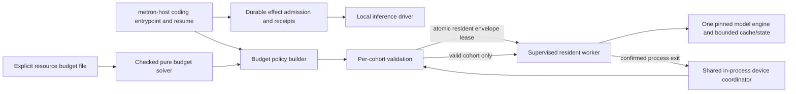

# ADR 0026: Resource-budget admission for resident inference workers

- Status: proposed
- Date: 2026-11-12
- Decision owners: agent-authored; human ratification pending
- Supersedes: none
- Related: [ADR 0021](0021-local-inference.md), [ADR 0025](0025-file-backed-inference-session-authority.md), [R-0012](../../knowledge/research/R-0012-context-and-resource-budget-admission.md)
- Tracking: [issue #52](https://github.com/kmosoti/Metron/issues/52)

## Context

The local inference adapter can retain a worker and its model/cache allocations
between request cohorts. Checking only current free memory or counting requests
does not reserve that resident envelope, and a warm worker can bypass a
spawn-time-only check. Larger context or executor counts can increase cache and
recurrent state without adding weights when one engine is shared; separate
workers may also replicate weights. No current evidence supplies conservative
upper bounds for every physical memory component or qualifies larger LFM3
contexts. Long-context and multi-agent quality evidence is workload-specific;
see [R-0012](../../knowledge/research/R-0012-context-and-resource-budget-admission.md).

## Decision

1. Keep model-quality/context policy separate from physical resource admission.
   A checked role budget calculator may plan requested allocations, but it does
   not increase the runtime's trained/profile limits or claim quality optimality.
2. Add an optional, explicit budgeted mode for local coding execution. In this
   mode, require complete, identity-bound conservative component upper bounds,
   a separate `kv_usable_tokens_lower_bound`, and supported accounting; reject
   missing, overlapping, overflowing or incompatible evidence before any
   persistent run-setting change, worker spawn, or request frame. Verify that
   page-rounded maximum profile demand fits within the usable-capacity lower
   bound, and the corresponding conservative four-byte pool fits within the
   fixed-pool upper bound. A target or upper bound on allocated pool bytes
   does not establish usable capacity. Legacy
   execution remains available with no resource-fit guarantee. Because the
   runtime cache dtype is not profile-pinned, the admitted paged KV payload
   bound uses four bytes per scalar to cover F16/BF16/F32 widths. The read-only
   role calculator may report a hypothetical two-byte BF16 payload estimate;
   it receives caller-supplied token capacity and does not derive it from the
   physical budget document.
3. Before reading policy contents or changing persistent run settings,
   canonicalize the existing mutable workspace and supplied budget path. Fail
   closed if the workspace is missing/not a directory, if the supplied
   absolute policy path differs from its canonical form, or if the canonical
   policy path is inside the model-writable workspace. This rejects symlink
   aliases in any path component and noncanonical spellings such as `..`,
   including aliases whose target is external. Ordinary relative paths are
   accepted when their absolute form is canonical. Read the policy from the
   canonical external path once per invocation; an operator may update the
   external regular file between invocations. This prevents workspace files
   from selecting operator policy on resume. It does not provide a general
   filesystem sandbox or replace the existing workspace sandbox and grants.
4. Admit by atomically reserving the full resident-worker envelope across
   drivers sharing a coordinator in one host process. Validate each cohort's
   policy identity, task/principal/profile scope, sequence and token capacity
   before `start` and before any frames, including when a worker is warm. Hold
   the lease throughout worker residency; release only after confirmed child
   exit. Unknown completion, cancellation, failed termination/wait, or uncertain
   exit retains/poisons capacity.
5. When a run opts into budgeted execution, persist in host run settings that a
   valid budget document is required on every later execution/resume. Revalidate
   the supplied document against profile and device each time; do not persist
   volatile capacity or the document in deterministic task/journal identity.
   An unbudgeted run may opt in on resume. Publish the settings change durably
   before dispatching effects. A command may fail after settings replacement
   but before directory-sync confirmation; in that case the requirement may
   already be persisted and the next resume must supply policy. Interrupted
   attempts can retry because existing remnants do not override current
   validated settings. Preserve existing durable effect admission and receipt
   semantics; adapter admission is an additional denial gate, not an authority
   grant.
6. Scope the guarantee to participating drivers sharing this in-process
   coordinator and to an operationally exclusive device scope. Do not claim
   machine-wide exclusion, or a strict allocator/process cap. A sampled free
   memory check cannot close races with unrelated processes.

## Architecture

The diagram describes the proposed boundary. The budget solver has no SDK or
device I/O. The host opts into policy. The adapter gate complements existing
durable admission and does not grant permissions. Release depends on confirmed
process exit, not request receipt settlement.

## Consequences

Budgeted mode may reject execution when resource evidence is incomplete even
if a runtime could happen to fit. This is intentional fail-closed behavior for
the requested guarantee. Existing unbudgeted compatibility has no such
guarantee. Context plans can distinguish feasible arithmetic from executable
profile limits; e.g. a planner request above the current 8192-token profile
ceiling is not executable merely because a KV estimate fits a declared budget.

The coordinator bounds only participating in-process drivers. Operational
exclusivity or a future shared owner is required to make a device-wide claim.
The admission envelope is conditional on provenance-backed upper bounds; JSON
values alone do not prove those bounds. A separate matched coding evaluation is
required before recommending a larger planner context or concurrent executor
workflow.

## Revisit when

Revisit if a backend-supported hard cap, cross-process resource coordinator,
heterogeneous role execution, or new conservative load/runtime bounds become
available; or when a frozen, matched Metron coding evaluation supports a
different context/concurrency policy.
