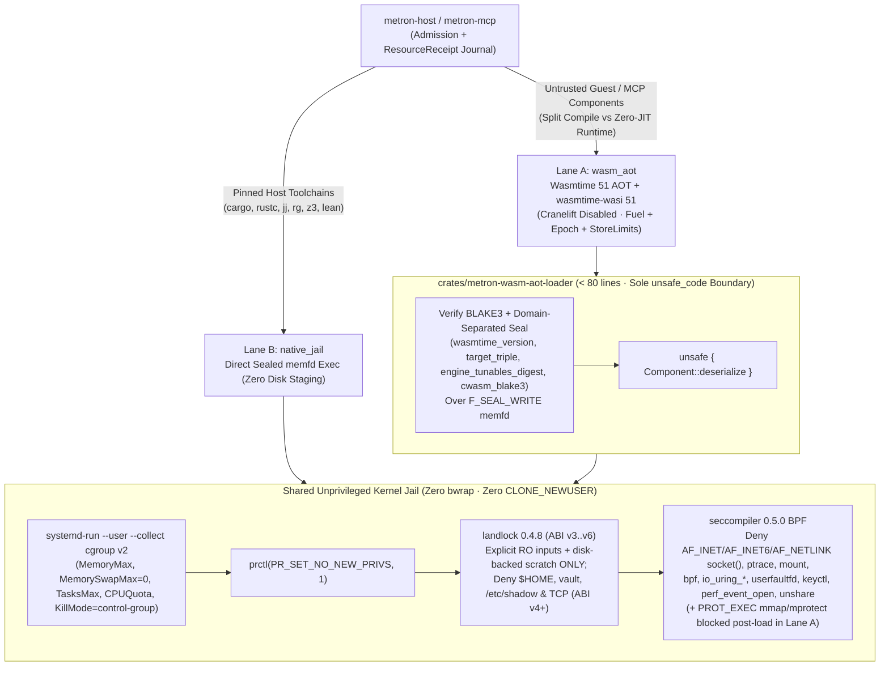

# 0029 — Two-lane zero-bubblewrap sandbox (`Wasmtime 51 AOT` + `Landlock` + `seccomp-bpf`)

- **Supersedes:** the `ToolId::Bubblewrap` (`bwrap` / `CLONE_NEWUSER`) and
  `Image::stage` disk-staging execution model in
  [ADR 0022](0022-alpha1-coding-and-memory.md); retains all `metron-core` /
  `metron-agent` purity, one-shot admission, `ResourceReceipt` accounting, and
  unknown-outcome hold invariants.

## Context

`ToolId::Bubblewrap` previously relied on `CLONE_NEWUSER` (`--unshare-user`),
which creates unprivileged user-namespace attack surface, requires an external
`bwrap` binary in `ToolCatalog`, and forced `Image::stage` to copy up to
512 MiB of verified tool binaries back onto disk because `bwrap` could not open
multiple `/proc/<pid>/fd/<n>` sealed descriptors across a new mount namespace.

Metron requires two distinct isolation capabilities without `bwrap` or
`CLONE_NEWUSER`, while preserving workspace-wide `#![forbid(unsafe_code)]`
everywhere except a minimal audited deserialization boundary:

1. **Lane B (`native_jail`):** Pinned host toolchains (`cargo`, `rustc`, `jj`,
   `rg`, `z3`, `lean`) and verifier candidates must execute directly from
   `F_SEAL_WRITE`-sealed `memfd` descriptors inside unprivileged kernel
   confinement (`systemd-run --user --collect` cgroup v2, `PR_SET_NO_NEW_PRIVS`,
   `landlock 0.4.8` ABI v3..v6, and `seccompiler 0.5.0` BPF).
2. **Lane A (`wasm_aot`):** Untrusted guest tools, static plugins, and MCP
   extensions must execute inside a deterministic, fuel- and memory-metered
   `Wasmtime 51` AOT runtime (`wasmtime-wasi 51` with Cranelift JIT disabled in
   the runtime host) wrapped inside the same `Landlock` + `seccomp-bpf` kernel
   jail (`PROT_EXEC` blocked post-load).

## Decision

Introduce `crates/metron-sandbox` and `crates/metron-wasm-aot-loader`, and
remove `ToolId::Bubblewrap` and `Image::stage`:

### Lane B (`native_jail`)

- `ToolId::Bubblewrap` is removed from `metron-protocol::toolkit` and
  `metron-host::coding_tools`; `Image::stage` is removed from
  `coding_tools/process.rs` and `coding_tools/verifier.rs`.
- `metron-sandbox` launches an unprivileged trampoline (`metron-jail`) inside
  `systemd-run --user --wait --pipe --collect` with cgroup v2 properties
  `Type=exec`, `ExitType=cgroup`, `KillMode=control-group`, `MemoryMax`,
  `MemorySwapMax=0`, `TasksMax`, `CPUQuota`, and `RuntimeMaxSec`.
- Before `exec`, `metron-jail`:
  1. Opens pinned executables, copies them into `memfd_create` with
     `MFD_ALLOW_SEALING | MFD_EXEC`, verifies exact SHA-256 digests, and adds
     `F_SEAL_WRITE | F_SEAL_GROW | F_SEAL_SHRINK | F_SEAL_SEAL`.
  2. Sets `prctl(PR_SET_NO_NEW_PRIVS, 1)`.
  3. Enforces `landlock 0.4.8` (targeting ABI v3..v6): grants read-only access
     only to explicit pinned toolchain/runtime inputs and read-write access only
     to explicit disk-backed scratch (and workspace when `writable == true`).
     `$HOME`, vaults, `/etc/shadow`, and TCP bind/connect (ABI v4+) are denied.
  4. Installs a `seccompiler 0.5.0` BPF filter returning `EPERM` on `socket()`
     with `AF_INET`, `AF_INET6`, `AF_NETLINK`, or `AF_PACKET`, and on
     `ptrace`, `mount`, `umount2`, `pivot_root`, `chroot`, `bpf`,
     `io_uring_setup`, `io_uring_enter`, `io_uring_register`, `userfaultfd`,
     `keyctl`, `add_key`, `request_key`, `perf_event_open`, `unshare`, and
     `setns`.
  5. Executes `/proc/self/fd/<n>` directly via `CommandExt::exec` (clearing
     `CLOEXEC` on inherited tool FDs such as `RUSTC` when running `cargo`).

### Lane A (`wasm_aot`) and `metron-wasm-aot-loader`

- Compilation (`metron-wasm-compiler`) is strictly separated from runtime
  execution: the runtime host builds `wasmtime 51` with Cranelift disabled
  (`default-features = false`, `features = ["runtime", "component-model"]`).
- Compiled `.cwasm` artifacts are wrapped with a domain-separated BLAKE3 +
  keyed HMAC/Ed25519 seal binding `(wasmtime_version, target_triple,
  engine_tunables_digest, cwasm_blake3)`.
- `crates/metron-wasm-aot-loader` (`< 80` lines) is the **sole crate in the
  workspace permitted `unsafe_code`** (enforced by `tests/architecture`),
  verifying the seal over a `F_SEAL_WRITE`-sealed `memfd` before calling
  `unsafe { Component::deserialize }`.
- Runtime execution enforces `consume_fuel(true)`, `epoch_interruption(true)`,
  and `StoreLimits`, wrapped inside the Lane B `Landlock` + `seccomp-bpf` jail
  with `PROT_EXEC` `mmap`/`mprotect` denied post-load, emitting deterministic
  `(fuel_consumed, peak_memory_bytes)` counters into `ResourceReceipt` evidence.

## Consequences

- `metron-protocol`, `metron-agent`, `metron-harness`, `metron-store-sqlite`,
  `metron-host`, and `metron-sandbox` remain `#![forbid(unsafe_code)]`.
- Zero `bwrap` binary, zero `CLONE_NEWUSER`, and zero 512 MiB disk copies are
  needed for tool execution.
- Kernel negative controls (blocked `$HOME` read `EACCES`, blocked network
  `socket()` `EPERM`, blocked `io_uring_setup` `EPERM`, cgroup timeout/OOM
  cleanup, tampered `.cwasm` seal rejection, and deterministic fuel exhaustion)
  are verified directly by automated tests.
