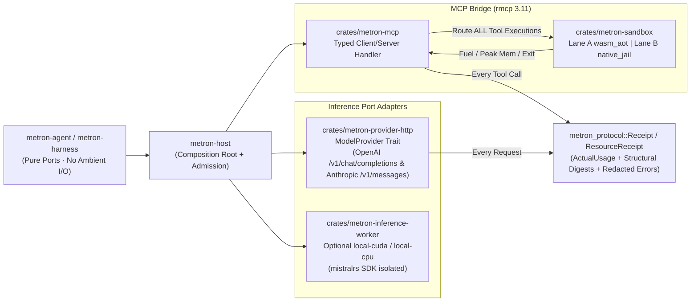

# 0030 — Pluggable `ModelProvider` HTTP adapter, optional `local-cuda`, and `rmcp 3.11` MCP sandbox bridge

- **Extends:** [ADR 0002](0002-hexagonal-crate-layout-with-a-single-composition-root.md),
  [ADR 0004](0004-receipts-for-every-external-operation.md), and
  [ADR 0029](0029-wasmtime-aot-landlock-seccomp-sandbox.md).

## Context

Metron previously coupled workspace builds and tests directly to the `mistralrs`
SDK inside `crates/metron-inference-worker` and lacked first-class adapters for:

1. Standard OpenAI- and Anthropic-compatible HTTP inference endpoints required
   for day-1 execution without local GPU hardware or proprietary weights.
2. Typed Model Context Protocol (`MCP`) client/server tool bridging (`rmcp 3.11`)
   that preserves Metron's authority, receipt accounting, and sandbox
   confinement guarantees.

Compiling `mistralrs` unconditionally on developer and CI hosts without GPUs
inflates build latency and disk footprint, while unguarded MCP tool handlers
would bypass `metron-sandbox` isolation and `ResourceReceipt` emission.

## Decision

Introduce two isolated boundary crates (`crates/metron-provider-http` and
`crates/metron-mcp`) and gate `mistralrs` behind optional Cargo features
(`local-cuda` / `local-cpu`):

### Key Rules

1. **`crates/metron-provider-http`:** Defines the pluggable `ModelProvider`
   port supporting OpenAI Chat Completions (`/v1/chat/completions`) and
   Anthropic Messages (`/v1/messages`). Disables HTTP redirects, bounds response
   payloads, redacts API keys from `Debug` and error types, and emits a
   `ResourceReceipt` (convertible to `metron_protocol::Receipt`) on every call.
2. **Optional `mistralrs` (`local-cuda`):** `crates/metron-inference-worker`
   marks `mistralrs` and `mistralrs-core` optional (`default = []`), exposing
   GPU builds via `--features local-cuda` (and CPU SDK builds via
   `--features local-cpu`) so `cargo test --workspace` succeeds cleanly without
   CUDA or local weights.
3. **`crates/metron-mcp` (`rmcp 3.11`):** Exposes a typed MCP client and
   `ServerHandler` bridge whose tool registry routes all tool execution strictly
   through `metron-sandbox` (Lane A `wasm_aot` or Lane B `native_jail`) and
   records a deterministic `ResourceReceipt` for every tool invocation.

## Consequences

- `cargo test --workspace --locked` builds and verifies all core, sandbox,
  provider, and MCP contracts with zero GPU dependency.
- `tests/architecture` enforces `#![forbid(unsafe_code)]` across both new
  crates, keeps `mistralrs` optional inside `metron-inference-worker`, and
  keeps `metron-agent` and `metron-protocol` pure.
