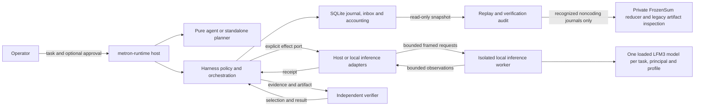

# Agent and harness usage

`metron-agent` provides pure task coordination. `metron-harness` provides
independently usable admission, effect orchestration and replay. Both are
first-class crates in Metron's root Cargo workspace. `metron-host` composes
them with SQLite storage and sandboxed tools; `metron-inference-worker` owns
the pinned local inference SDK.

[Bounded coding](coding.md) is the alpha.1 development path. GPU generation is
verified, while independently accepted model-written coding and the required
resource gates remain incomplete. The public workflow is coding-specific;
historical sum journals have only a private read-only replay path.



Cognition proposes coding intents; host policy and SQLite admission control
execution. Every effect and coding verifier is supplied through an explicit
port. The production harness has no ambient filesystem fallback. SQLite
retains receipts, accounting, and recovery state. An admitted dispatch whose
result is unknown is not repeated automatically. Historical sum replay uses a
separate private reducer and read-only artifact inspection; it has no execution
or reconciliation route.

The crate API exposes `metron_harness::orchestrator::drive_with_driver` for
explicit effect driving and
`metron_harness::orchestrator::drive_coding_with_driver` when a trusted
`metron_harness::orchestrator::CodingVerifier` is supplied. Both require a
`metron_harness::policy::EffectDriver`; there is no implicit `drive` or
built-in scripted driver.
`metron_harness::orchestrator::Checkpoint::EffectReturned`
marks return from the supplied effect before receipt persistence, not durable
filesystem completion. Controlled scripted replies and fixtures are confined
to the dev-only `metron_testkit::coding` module.

## Build and run

The repository pins its Rust toolchain in `rust-toolchain.toml`. From the repository root,
use `cargo build -p metron-host` to build `metron-runtime`.

Local inference uses an explicitly installed, pinned model and its tokenizer,
template, configuration, and license files. Install either qualification artifact with
`metron-runtime model install --artifact control --cache-dir DIR` or replace
`control` with `challenger`. Installation requires `curl` with HTTPS support and
verifies the full bytes of each file. The model is stored at the cache root; the
auxiliary files are stored under `auxiliary/<pinned-revision>/`. Keep a
`tokenizer.json` out of the cache root so the worker uses the embedded GGUF
tokenizer. The cache may be used offline after installation.

Create a candidate configuration with `metron-runtime model candidate --artifact
control --device cpu --threads 2 --sequences 1 --worker /absolute/path/to/worker
--model-cache /absolute/path/to/cache --output candidate.json`. CUDA selection
uses `--device cuda:UUID`; the recorded device identity includes the actual UUID,
model, memory, and driver. Candidate creation verifies the installed bytes and
does not download anything.

To build the local worker, first run `cargo fetch --locked`, then run
`python3 tools/prepare-mistralrs-cache.py` from the repository root. Limit backend
builds to one job with debug information and incremental compilation disabled.
For manual CUDA builds also set `CUDAFORGE_THREADS=1`.

### Local worker and comparisons

The worker uses native mistral.rs at commit `fb4cdc3730dc64b366724e7637a205a8b7747499`; the published 0.9.5 release does not contain LFM3 support. CPU is the default build; CUDA is optional. After fetching dependencies and preparing the backend cache as above, a CUDA build from this workspace can use:

```sh
export CUDA_HOME=/path/to/cuda
export CUDA_ROOT="$CUDA_HOME" CUDA_PATH="$CUDA_HOME"
export PATH="$CUDA_HOME/bin:$PATH"
export LD_LIBRARY_PATH="$CUDA_HOME/lib64${LD_LIBRARY_PATH:+:$LD_LIBRARY_PATH}"
export CUDA_COMPUTE_CAP=86 CUDAFORGE_THREADS=1 CARGO_BUILD_JOBS=1
export CARGO_INCREMENTAL=0 CARGO_PROFILE_RELEASE_DEBUG=0
cargo build --release --locked --offline -p metron-inference-worker --features cuda
```

`86` targets compute capability 8.6; use the capability of the intended GPU. The compiler and toolkit must be compatible. Building CUDA kernels consumes host RAM; inference VRAM is a separate resource and a successful build does not establish a viable runtime memory envelope.

The operational comparison reads the official Q4_K_M, Q6_K and Q8_0 GGUF files from the cache root, pinned at `cd0c74c575b5c416f3011b5b4c298077f26ca8c2`, and verifies their full sizes and SHA-256 hashes before use. The exact pins are:

| GGUF file | Bytes | SHA-256 |
| --- | ---: | --- |
| `LFM3-1.7B-Q4_K_M.gguf` | 1,099,627,808 | `3793e1e6e2266919d6e015287221b41100175a98eddaba92e111aed3b05c93c4` |
| `LFM3-1.7B-Q6_K.gguf` | 1,427,638,304 | `54e1bd947c77167823d45bf495f1c3e2d226ca7fb242f83cfa141ee3a6ab55c6` |
| `LFM3-1.7B-Q8_0.gguf` | 1,846,238,496 | `8f6b24182258205e9e01e21f1f24a1f208c1e8115578825d202ce39976af20b6` |

The existing installer supplies `control` (Q4_K_M) and `challenger` (QAD-Q4_0); obtain Q6_K and Q8_0 separately from that pinned repository revision before an offline comparison. The auxiliary files remain under the pinned auxiliary revision. With a CUDA worker and a suitable GPU, run:

```sh
metron-runtime model compare --worker /absolute/path/to/metron-inference-worker \
  --artifacts /absolute/path/to/cache --output /absolute/path/to/results
```

Optional `--quant q4|q6|q8` and `--concurrency 1|2|4|8` restrict a run. Without filters the comparison covers all three quantizations and concurrency levels. A profile has one isolated worker and one loaded model shared by requests scoped to the same task, principal and profile. Reasoner returns text; ToolSelector returns a closed proposal, not authority to execute a tool. Reasoner latency is measured to usable streamed content; selector latency is measured to a valid final proposal. The baseline uses an 8,192-token context with output reserved, thinking disabled, and prefix cache, paged attention and CUDA graphs disabled.

Local requests permit up to 64 KiB of decoded context and a 512 KiB framed request. Replies remain bounded to 64 KiB and existing output and receipt limits still apply. Legacy task context remains limited to 4 KiB. Each comparison request has a durably admitted one-shot permit and its own identity and receipt. An uncertain outcome blocks its session and is not retried automatically. Session identifiers bind the canonical UTF-8 directory, profile, phase and frozen inputs; directory aliases share the same identity. Use a fresh session directory for an independent trial.

The fixed comparisons test short and near-8K inputs across three repetitions. An operational candidate must meet correctness, both roles' p95 usable-output latency below one second, a process GPU memory peak at most 4 GiB and at least 1 GiB free GPU memory; concurrency 1 is a baseline rather than a selectable candidate. There may be no acceptable candidate. The staggered case records whether the reasoner SDK stream is still awaiting its terminal response when the selector reaches the worker; actual backend batch membership remains unknown. These results do not automatically promote a profile: production selection retains the separate frozen-corpus qualification gate. See [ADR 0021](adr/0021-local-inference.md) and [R-0010](../knowledge/research/R-0010-lfm3-native-inference.md).

## Public task entry and historical audit

Use the `coding` commands documented in [bounded coding](coding.md) for new
execution. Generic `run`, `resume`, `approval` and `reconcile` entry points
reject before opening a database, loading a profile or starting a worker.
`coding resume` performs a read-only audit first and rejects a legacy task
before writable store or effect setup. Generic `replay` and `verify` are
read-only; replay uses the coding engine for recognized coding journals and the
private FrozenSum reducer for recognized legacy sum journals. Legacy-sum
verification inspects the recorded artifact read-only. This does not mean
all historical engine/profile variants are empirically replay-qualified. The
available copied-journal evidence covers eight databases: seven passed; the
obsolete-profile `sum-local-agent/v2` sample rejects identically to the prior
host, and no persisted `sum-local-harness/v2` specimen was located. The
verification record retains the specimen scope and provenance.

### Pinned tool inventory

`metron-runtime toolkit inspect CATALOG.json` checks operator-selected executable
hashes before fixed version probes and reports the linked SQLite/FTS5 capability.
On Linux, executable bytes are copied into a bounded sealed image and the
verified image is executed, so replacing the original file cannot substitute a
different executable. Interpreters and shared libraries remain operator-trusted
dependencies; this check does not qualify a full distribution or sandbox.
The report is inventory only; it cannot authorize tools or qualify a runtime
profile. Version output and process waits are bounded. Missing files, digest or
version mismatches and uncertain probes return a nonzero status.

A catalog has `schema_version: 1` and a `tools` array. Each entry contains `tool`
(`jj`, `ripgrep`, `z3`, `lean`, `cargo`, `rustc` or `bubblewrap`), an absolute
`executable`, its full `sha256`, and `version_prefix`. Use immutable trusted tool
paths rather than auto-installing shims. The catalog digest can be bound into a
coding-task contract; it is not a permission set.

The public [admission models](../crates/metron-harness/contracts/README.md) provide positive/negative SMT
and Lean checks for development. The [experimental coding entry](coding.md) routes these tools through
confined, admitted effects. [D-0005](../knowledge/decisions/D-0005-alpha1-delivery.md)
tracks alpha.1's implementation and release evidence.

## Resume, operator decisions, and audit

Continue a persisted coding task with `coding resume`; inspect its current
durable state with `coding inspect`:

```sh
metron-runtime coding resume --run-dir /absolute/private/run
metron-runtime coding inspect --run-dir /absolute/private/run
```

`coding inspect` opens the journal read-only, validates its chain, accounting,
projection and behavior replay, and reports the logical tick, intent statuses,
approval requests, evidence revisions and IDs, and reconciliation epochs or
leases. It needs no coding settings, model, worker, or effect driver.
`coding resume` reopens the persisted coding configuration and continues known
work; it does not retry an uncertain effect. An unknown result retains its
reservation until an operator selects an existing trusted receipt for
reconciliation.

Each coding operator command validates the single-task journal read-only before
opening it for a requested write. The operator is scoped to the coding run and
does not load its worker, model, or effect driver.

Record a decision bound to the exact pending approval request and action digest:

```sh
metron-runtime coding approval --run-dir /absolute/private/run \
  --request-id ID --action-digest DIGEST --decision approve --command-id COMMAND
```

Use `deny` instead of `approve` to reject the request. The decision command
records the approval only; run `coding resume` separately to continue. Advance
the logical clock explicitly with a checked expected value and command identity:

```sh
metron-runtime coding advance-tick --run-dir /absolute/private/run \
  --expected-tick CURRENT --new-tick NEXT --command-id COMMAND
```

A lease or approval expires against that logical clock, not wall time.

Reconciliation selects an already-recorded receipt for an eligible uncertain
intent. The evidence ID, expected evidence revision and reconciliation epoch
must match the read-only inspection; the store enforces frontier, lease and
known-usage rules:

```sh
metron-runtime coding reconcile --run-dir /absolute/private/run \
  --intent INTENT_ID --evidence EVIDENCE_ID \
  --expected-evidence-revision REVISION --expected-epoch EPOCH \
  --command-id COMMAND
```

This operation records selection and settlement from persisted evidence. It
does not synthesize a receipt, dispatch an effect, or run cognition. Stale
selection is rejected; conflicting evidence, unknown usage, and other
ineligible states remain unresolved for investigation. Costs are never inferred.
The generic `resume`, `approval` and `reconcile` commands are rejected before
opening a database; use the coding-scoped commands above. Generic `replay` and
`verify` remain read-only for recognized history and emit versioned CLI reports. For
coding runs, use `coding audit` to check artifact and acceptance-report
integrity; generic `verify` does not substitute for that coding-specific check.

`coding audit` is also read-only. It checks the coding journal and behavior
replay and validates retained coding artifact and acceptance-report integrity
when present; it does not make an uncertain outcome known. Coding command
responses report action outcomes in JSON. Their process status distinguishes
completed/succeeded commands (0), other task outcomes such as blocked,
rejected or integrity failure (4), and command input/setup errors (2).
Generic replay/verify use versioned `CliReport` JSON and exit codes 0–6 as
described by their command results.

An alpha.0 audit supports up to 4,096 journal records and 8 MiB of cumulative
canonical journal bytes. An audit above either limit returns operational exit 6;
the history remains intact and the report does not assert an audit result.
