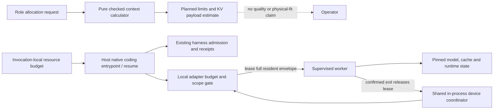

# Context planning and resource-budgeted coding

Context planning and device admission answer different questions. The
calculator estimates a requested role allocation using a hypothetical 2-byte
BF16 paged payload formula; it does not guarantee model quality or device fit.
Its `usable_tokens` value may be caller-supplied, derived from a separate
declared memory envelope, or capped by both; derived memory capacity remains
conditional on declared disjoint upper bounds. Budgeted coding mode separately
requires explicit upper bounds for the resident worker envelope and uses a
conservative 4-byte-per-scalar paged KV upper bound because runtime `Auto` dtype
is not pinned in the profile. Neither tool raises the current profile ceiling.

## Read-only context planning

Run `metron model budget --input FILE` with a JSON allocation request:

```json
{
  "planner_min": 4096,
  "planner_desired": 32768,
  "planner_output": 512,
  "executor_count": 4,
  "executor_context": 8192,
  "executor_output": 512,
  "usable_tokens": 65536
}
```

Alternatively, provide a `memory` object with `device_budget_bytes`,
`external_reserved_bytes`, `weights_upper_bytes`, `recurrent_upper_bytes`,
`workspace_upper_bytes`, `runtime_upper_bytes`, `headroom_bytes`,
`scalar_bytes`, `accounting`, and `provenance`. The four `*_upper_bytes`
components must be known, disjoint, and provenance-backed; incomplete memory
objects are rejected. No example bounds are supplied because they require
measurements specific to the device, model artifact, worker and runtime.
With `memory`, the calculator subtracts external reservation, the four required
component bounds and headroom from `device_budget_bytes`, reserves one paged
block, and derives a token ceiling using `scalar_bytes` (2 or 4). When both
`usable_tokens` and `memory` are present, it uses the smaller limit. At least
one of them is required. A derived ceiling is conditional on the declared
bounds, not a measurement of physical fit. Without the memory object, the
caller-supplied token capacity has no physical-fit interpretation.

The calculator returns a planned allocation with `runtime_supported: false`,
`physical_fit: "conditional_on_declared_bounds"` when a memory object supplies
the ceiling, or `physical_fit: "not_evaluated"` when only caller-supplied tokens
are used. It also reports whether the request fits the current runtime ceiling.
Those fields are consequential: the current adapter uses one profile for all
requests and supports contexts only up to 8192 tokens. It does not implement
heterogeneous planner/executor scheduling. The calculator does not silently
reduce the requested executor count or context. Infeasible requests return an
error.

The returned KV value uses a hypothetical two-byte BF16/F16 paged payload by
default, or the selected `memory.scalar_bytes` (2 or 4) if provided. It does
not include weights, recurrent state, workspace, load peaks, runtime overhead,
allocator overhead, or physical memory competition except where those are
separately included in the caller's declared memory envelope. It is not a fit
claim. Current profile and trained context limits remain separate constraints.

## Optional local resource budget

`coding experiment` and `coding resume` accept `--resource-budget FILE` for
native profile execution. The file is invocation-local policy input; it is not
written into the task genesis or journal. A run started with this option
persists a host-settings requirement that every later execution/resume supply a
valid `--resource-budget FILE`; omitting the flag is rejected before execution.
The document is revalidated against the selected profile/device on each
invocation. A previously unbudgeted run can opt into the requirement on resume.
`--resource-budget` is rejected when the selected coding configuration does
not use the native profile. Runs without this option preserve legacy behavior
without a physical-fit guarantee.

Opting in on resume updates the host run settings durably before any model or
tool effects are dispatched. If an attempt is interrupted before that update
commits, retry by supplying the budget file again. If settings replacement
commits but reporting its directory sync fails, the command fails before
dispatch, but the persisted run may already require the budget file on the next
resume. Existing incomplete remnants from an interrupted update do not override
the current validated settings or block a retry.

The budget file must resolve to a canonical path outside the model-writable
workspace. The workspace must already exist and resolve to a directory.
Symlink aliases are resolved before policy contents are read; a file that
resolves inside the workspace is rejected. The host reads the resolved
canonical external path. This preserves the distinction between operator
policy and files the coding model can modify; it does not replace the existing
workspace sandbox and grants.

Schema version 1 has these fields (unknown fields are rejected):

```json
{
  "schema_version": 1,
  "profile_digest": "<digest for selected native profile>",
  "device_uuid": "GPU-<exact CUDA device UUID>",
  "device_budget_bytes": 8589934592,
  "external_reserved_bytes": 1073741824,
  "accounting": "disjoint_upper_bounds",
  "route": "paged_scalar4_upper_bound",
  "weights_upper_bytes": null,
  "recurrent_upper_bytes": null,
  "workspace_upper_bytes": null,
  "runtime_upper_bytes": null,
  "fixed_kv_pool_upper_bytes": null,
  "kv_usable_tokens_lower_bound": null,
  "headroom_bytes": 536870912,
  "provenance": "<source and method for each conservative bound>"
}
```

The `null` values above deliberately make the example non-runnable: replace
them with provenance-backed conservative bounds. In addition to the required
upper bounds, budgeted mode requires `kv_usable_tokens_lower_bound`, a
provenance-backed lower bound on usable KV capacity. The estimated full
profile demand (each maximum-sequence context rounded to pages and combined)
must not exceed this lower bound. A configured cache target and fixed-pool
upper bound alone do not establish guaranteed usable capacity. Do not invent
sample numbers or treat a JSON value as evidence by itself.
Budgeted execution fails closed if any required bound is absent, the profile or
device identity mismatches, accounting is not explicitly disjoint, the fixed
KV pool is insufficient, or the checked sum exceeds
`device_budget_bytes - external_reserved_bytes`. The entire fixed KV pool is
charged, alongside the weights, recurrent state, workspace, runtime overhead
and headroom. The `paged_scalar4_upper_bound` route reserves tensor payload at
four bytes per scalar across the configured maximum sequences and context,
covering F16/BF16/F32 widths, and charges the declared fixed-pool upper bound
once. It separately requires the full page-rounded maximum sequence/context
demand to fit within `kv_usable_tokens_lower_bound`, and the conservative
four-byte pool required by that usable-capacity lower bound to fit within
`fixed_kv_pool_upper_bytes`. A target or upper bound on allocation does not
prove usable capacity. All submitted bounds are
conditional, user-supplied assumptions, not verified hardware guarantees. Do
not derive upper bounds from model file size or a single idle sample.

The adapter atomically reserves the full maximum resident-worker envelope
before spawn, across drivers using the same coordinator in this host process.
It checks scope and cohort limits before frames on every cohort, including a
warm worker. A receipt does not release the reservation. Capacity is released
only after confirmed child exit; uncertain exit retains capacity. This does not
coordinate unrelated processes or other Metron hosts, so device exclusivity is
an operational precondition for treating the envelope as device admission.
There is no strict CUDA allocator/process cap.

## Boundary diagram



The host supplies opt-in policy, while durable admission continues to govern
effects. The adapter gate adds a capacity denial condition. The planner is
read-only and has no runtime authority.

## Evidence and limits

Context length and task performance are not interchangeable. Research found
position-sensitive use of long contexts in evaluated models and workloads;
multi-agent results also vary with task structure. See
[R-0012](../../knowledge/research/R-0012-context-and-resource-budget-admission.md)
for source links, scope, estimates and the required matched coding evaluation.
The current LFM3 profile remains at its established 8192-token cap. Experimental
chunking and a planner plus four executor workflow remain unqualified.
