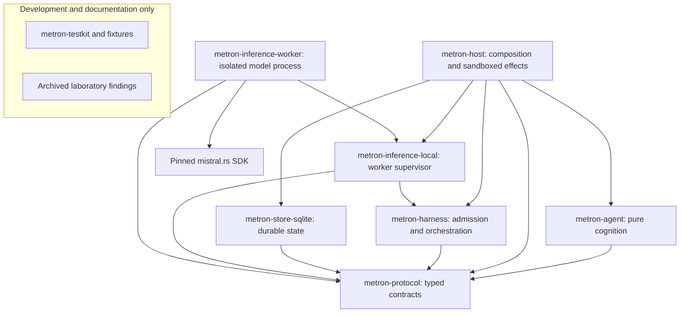
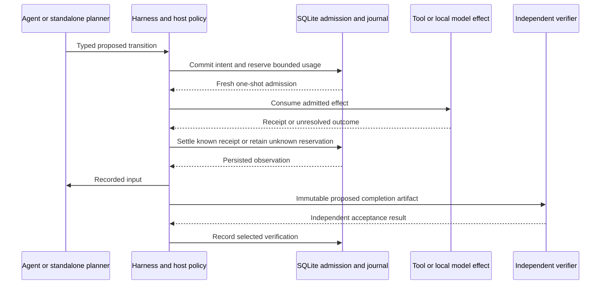

# Architecture overview

Metron develops a Rust-native agent and execution harness in one Cargo workspace.
`metron-agent` and `metron-harness` are the primary crates. The host, storage and
local inference adapters compose their explicit interfaces. Test fixtures and
operational measurements validate these components; they are not product layers.

## Crates and the direction of dependency

The support/documentation subgraph is outside runtime dependency and authority
flows.

Arrows represent Rust dependencies. The supervisor communicates with the worker
through bounded framed requests; it does not link the SDK. Agent/protocol code
does not perform I/O. Test fixtures and development support remain outside
runtime authority. Archived research records and report data are documentation,
not executable product components.

## Execution and authority

Model output proposes work. Host grants and durable admission control execution.
Roles, personas, notes and tool content do not grant authority. Unknown execution
retains its reservation and is not automatically repeated. Final acceptance is
separate from the model's completion claim.

## Repository layout

| Path | Responsibility |
| --- | --- |
| `crates/metron-agent`, `crates/metron-harness` | Primary agent and harness APIs |
| Other supporting crates under `crates/` | Protocol, storage, host and local inference |
| `tests/architecture` | Product dependency and authority boundaries |
| `crates/metron-testkit`, crate-local tests | Development-only controlled fixtures and adapters |
| `knowledge/` | Research, decisions and dated evidence |
| `docs/` | Architecture, setup and interface documentation |
| `knowledge/archive/laboratory/` | Historical Boolean-laboratory reports and research evidence |

The root owns the single `Cargo.toml`, `Cargo.lock` and dated Rust toolchain pin.
The [product scope decision](../adr/0024-product-scope-and-laboratory-archive.md)
records why the Boolean laboratory is archived rather than included in the
current executable product. [ADR 0023](../adr/0023-first-class-agent-and-harness.md)
records the workspace consolidation and compatibility obligations.

## Development status

Durable execution, scoped tools/memory and local CUDA generation are implemented.
Alpha.1 remains gated on independently accepted model-written coding and the
required inference/resource evidence. See [coding usage](../coding.md) and
[issue #7](https://github.com/kmosoti/Metron/issues/7).
