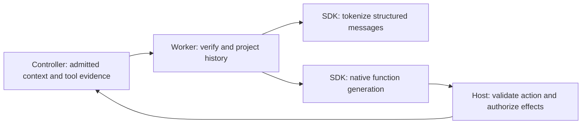
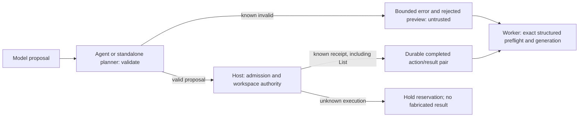
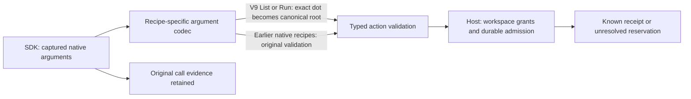
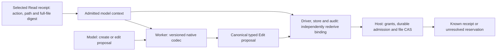

# Experimental bounded coding

The coding entry point connects a version-3 task to workspace tools, a local
model, scoped notes and independent artifact acceptance. Both `agent` and
`harness` modes use the same admission, reservation, receipt and verification
boundaries. The standalone planner does not instantiate `metron-agent`.

Coding remains experimental until the native task and resource gates in
[D-0005](../knowledge/decisions/D-0005-alpha1-delivery.md) pass. A successful
controlled script, a model response or a candidate-written test does not select
a production profile. See [ADR 0022](adr/0022-alpha1-coding-and-memory.md)
for the authority diagram.

Native coding recipe v3 uses LFM3's XML function-call format through the Rust SDK.
The admitted model step supplies its phase/tool catalog separately from prompt
text. A versioned tokenizer correction preserves the GGUF vocabulary and changes
the 14 user-defined token flags required by that format; model load verifies the
source artifacts and the SDK checks every token ID. Its profile tokenizer
identity describes that transform; the worker separately logs the generated file
hash. Native calls are proposals and pass the same domain and admission checks
as other coding actions. See [the compatibility evidence](../knowledge/observations/O-0008-coding-loop-and-confinement.md#native-tool-call-tokenizer-incompatibility).

Native coding recipe v6 adds a phase-filtered Lark constraint to the SDK's
native XML function-call path. Its experimental catalog is limited to `plan`,
`edit`, `read`, `run` and `finish`; any other catalog is rejected before
sampling. The worker keeps the original parsed call as evidence and applies the
same host action and policy checks. The SDK's XML parser removes a framing
newline, treats a bare `null` as null, and has closing-tag limitations, so the
format does not preserve every possible raw file string. See
[the XML decoding evidence](../knowledge/observations/O-0011-native-xml-constraints.md).

The v3.5 controller can provide bounded validation feedback after a known invalid
model proposal. The model must submit a new proposal; the third invalid proposal
ends the task. Unknown executions and authorization failures still stop the
loop. See [the correction contract](../knowledge/observations/O-0009-known-proposal-feedback.md).

Recipes v4 and v5 use streaming JSON-schema actions filtered by the admitted
phase/tool catalog. The v3.7 controller leaves output encoding and recovery
feedback to the recipe. This mode
constrains argument types and paths that the pinned SDK's XML grammar does not
enforce. It retains the corrected tokenizer and all host authorization checks;
see [the decoding evidence](../knowledge/observations/O-0010-coding-decoding-contracts.md).

Recipe v5 admits canonical and tool-first property orders and disallows JSON
whitespace outside string values. File contents retain their whitespace. The
worker verifies property-order preservation before sampling; the host validates
every resulting action independently. Historical controller and recipe identities
remain available for replay, including v3.6's original recovery wording.

Recipe v7 uses the v6 native XML grammar with bounded paired tool history. A
completed supported action and its matching observation appear as an assistant
function call followed by a tool result; a host-owned intent digest correlates
the pair. Task, plan, memory, tool content and file digests remain untrusted
inputs. An omitted action is explicitly marked as omitted and produces no
function call. Initial requests likewise have no pair. Validation feedback is
placed after the pair. The worker checks that the structured history agrees with
the admitted context and tokenizes the same structured messages used for
generation. This recipe remains experimental and does not establish coding
acceptance or batching/cache qualification.



The v3.10 controller (context11) includes bounded diagnostic data after a known
invalid proposal: the actual validation error, up to 512 UTF-8 bytes of the
rejected proposal, and an explicit truncation flag. The preview is untrusted
text, never an executed call. It is bound to the recorded model observation;
unknown execution still holds and three known invalid proposals still stop.
At the context limit, the controller can omit a previous complete action as a
whole, retaining its digest, provenance and observation. It preserves the
current model observation needed to bind feedback. Older controller routes keep
their previous feedback bytes.

Recipe v8 retains V7's exact structured-message preflight and adds the existing
`list` action only when admitted by policy. Its directory can be null for the
workspace root. V6/V7 keep their five-tool catalogs. Completed List results use
the same actual action/receipt pairing; omitted actions create no assistant
call. Feedback previews are labeled `rejected_preview_untrusted` in model-facing
data. Native completion remains unqualified; see
[the execution evidence](../knowledge/observations/O-0013-native-coding-feedback.md).



Recipe v9 accepts the conventional `.` spelling for the workspace root in
native `list.directory` and `run.directory` arguments. The adapter records the
original arguments and converts that spelling to the existing canonical null
root before domain validation and admission. Completed history uses the actual
canonical action. This adds no path or tool authority: file paths and all other
directory strings retain their existing validation. Earlier recipes still reject
`.` and replay their original results. V9 uses the existing context11 controller;
its native coding acceptance remains unqualified.



Recipe v10 exposes native `create(path, content)` and `edit(content)` calls.
Both produce the existing canonical Edit action and require the existing Edit
grant. Create uses no-replace semantics. Edit replaces the file from the latest
completed Read turn: the observation must be successful and untruncated, retain
one file reference with the same path as the Read action, and omit no references.
A requested line range can be partial; its digest still identifies the full file.
This contract does not assert that the model saw the whole file.

The adapter obtains that path and digest from the admitted context. It does not
resolve a target from task prose or a model-supplied digest. A missing, failed,
omitted or mismatched Read cannot bind an edit. The host still rejects a stale
version or creation over an existing file. Driver, receipt and audit validation
rederive the canonical action using the persisted profile and prepared input;
context-free validation is unavailable for v10. No extra filesystem read occurs
during normalization.

V10 string arguments use JSON encoding inside XML, with escaped markup delimiters,
then decode exactly once after SDK parsing. Recorded native history uses the same
encoding and file-call signatures. Existing output bounds still apply: oversized
encoded evidence produces an explicit overflow and an invalid proposal. Earlier
recipes retain their original argument and history handling. Interface checks do
not establish successful model-written coding; see
[the native file-tool observations](../knowledge/observations/O-0014-native-file-tool-contract.md).



## Inputs and invocation

Provide separate absolute paths for an owner-private workspace and the private
run directory. The workspace contains only candidate-accessible project files;
keep model artifacts, credentials, memory databases, journals and evaluator
inputs outside it. The run directory must not already exist for a fresh task.
Process scratch must reside on disk. Linux user namespaces, bubblewrap, a user
systemd manager and cgroup v2 are required; isolation failure has no fallback.

The operator supplies these bounded JSON inputs:

| Input | Contract |
| --- | --- |
| Task | `CodingTaskData`: schema 3, family `coding-v1`, unique task ID, principal/project, objective, acceptance/tool/model digests, optional memory collection, request/tool budgets and decision ceiling. |
| Policy | `CodingPolicy`: matching principal/project/collection, workspace root, allowed tools/programs, mutation approval and file/output/process limits. |
| Catalog | Pinned executable paths, byte digests and version prefixes; see [toolkit inventory](agent-harness.md). A catalog grants no authority. |
| Profile | Hardware-bound Q4 LFM3 profile with pinned artifact, tokenizer, template, worker and recipe identities. |
| Acceptance | A frozen built-in spec, currently `{"version":1,"kind":"calculator-v1"}` or the frozen nonempty-line repair spec. Custom trusted callers can implement the public `CodingVerifier` port. |

Compute identifiers through the Rust serializer rather than hashing an external
JSON reformatting:

```sh
metron-runtime coding identities --catalog catalog.json --profile profile.json --acceptance acceptance.json
metron-runtime coding experiment --experimental --run-dir /absolute/private/run --task task.json --policy policy.json --catalog catalog.json --acceptance acceptance.json --profile profile.json --worker /absolute/pinned/metron-inference-worker --artifact /absolute/models/LFM3-1.7B-Q4_K_M.gguf --mode agent
```

Use `--mode harness` for the standalone caller. `--script script.json` replaces
the profile/worker/artifact arguments for controlled tests; it uses a distinct
model identity and never represents native generation. Native attempts require
`LiquidAI/LFM3-1.7B` Q4_K_M and verified local CUDA hardware when the profile
selects CUDA. Artifacts are loaded offline; there is no hosted fallback.

## Actions and observations

The first model response records a plan. Later responses propose one typed action:
list, literal ripgrep search, bounded read, compare-and-swap edit, a permitted
Rust program, private JJ snapshot/diff, SMT, Lean, scoped memory or finish.
Use workspace-relative paths and JSON `null` for the root directory:

```json
{"tool":"list","directory":null}
{"tool":"read","path":"README.md","first_line":1,"line_count":40}
{"tool":"run","program":"cargo","args":["test","--offline"],"directory":null}
```

An edit with `expected_digest: null` creates a missing file. Replacing a file
requires its complete observed digest. Read excerpts retain a digest of the
complete file. Tool observations record status, truncation, file references and
whether the process tree is closed. An unavailable file is not a reason to
repeat an unchanged failed read.

The current controller retains the model's plan, a compact action summary and
at most two bounded tool views. The model sees explicit truncation and file
hashes needed for edits; the journal and state retain evidence references and
full-output hashes. Planner/coder/reviewer personas do not change grants.
Each prior controller and recipe keeps its own replay behavior.

JJ operates on a private bounded source copy; its repository metadata is never
mounted from the caller's checkout. Receipts identify content trees rather than
clock-dependent commit IDs. Ripgrep searches a private source copy literally.
Cargo and rustc run with an isolated network, clean environment, disk scratch
and cgroup process/memory/deadline controls. Host toolchains and shared libraries
remain trusted inputs; executable pinning does not qualify an entire OS image.
The disk reserve monitor is sampled and is not a filesystem quota.

## Scoped notes

The memory database path must be absolute, so persisted settings reopen the same
database independently of the caller's working directory.


The host binds every query and append to the task's principal, project and
collection. Model parameters cannot select a different scope. Grant a collection
explicitly before using it in a task:

```sh
metron-runtime coding memory-grant --db /absolute/private/notes.sqlite --principal operator --project project --collection notes
metron-runtime coding memory-revoke --db /absolute/private/notes.sqlite --principal operator --project project --collection notes
```

Notes are immutable model-authored claims, with source task/evidence and content
hashes. Contradictory notes remain separate. They never become verification or
permissions. Grants are checked transactionally on each operation and again
before model requests that could expose retrieved context. Revocation blocks
further use of that context. SQLite stores canonical notes; FTS5 is rebuildable.
Database files and sidecars must be private regular files.

A v3.8 retrieval records the selected note identities and annotation references in its
receipt. The next model request records which bounded excerpts were visible,
whether known candidates were omitted, whether more candidates existed, and the
profile that defines the input budget. The model sees notes as unverified data;
the worker's actual token count remains authoritative.

An operator may annotate a note as stale, or as conflicting with another note in
the same scope, using evidence from a completed ordinary tool action in an
audited coding journal:

```sh
metron-runtime coding memory-annotate --run-dir /absolute/private/run --dispatch ANNOTATION_DIGEST --target-dispatch NOTE_DISPATCH --source-evidence TOOL_EVIDENCE_DIGEST --kind stale --reason 'Superseded by the observed file'
```

For a conflict use `--kind conflicts-with --related-dispatch OTHER_NOTE_DISPATCH`.
The source journal must match the task's scope and pass audit and behavior replay;
the referenced receipt must be selected, successful and have closed its process
tree. The collection still needs an active grant. Annotations are manual host
assertions; they do not change the note's unverified trust label or grant authority.

## Completion and recovery

`finish` requests verification of a frozen file set and its implied directories.
The grader compiles that immutable source separately and runs its sealed binary
with a fresh scratch directory for each private case. The candidate cannot
access expected outputs or the grader's build cache. Only an artifact-bound
trusted verdict completes the task. Unknown cleanup or grading remains blocked;
a successful candidate test does not set the verdict.

```sh
metron-runtime coding resume --run-dir /absolute/private/run
metron-runtime coding audit --run-dir /absolute/private/run
```

Audit is read-only and uses recorded observations. It needs neither the model
nor the original workspace, and checks retained artifact/report integrity when
present. Resume never silently redispatches an uncertain effect. Outstanding
reservations remain held. An unresolved process marker prevents workspace reuse
until cleanup has been established by an operator; deleting a marker alone is
not cleanup evidence.

## Local verification

Run the ordinary runtime workspace checks. Physical tool probes are explicitly
ignored by default because they require a pinned local catalog and the Linux
sandbox. Execute them with a catalog stored on disk:

```sh
METRON_CODING_PROBE_CATALOG=/absolute/disk/tool-catalog.json cargo test --locked -p metron-host --bin metron-runtime -- --ignored
```

These probes cover admitted JJ/rg/SMT/Lean effects and receipt replay, namespace
and descendant cleanup, plus frozen-build execution and case isolation. Native
calculator/repair acceptance and R-0008/R-0009 efficiency qualification are
separate release evidence.
