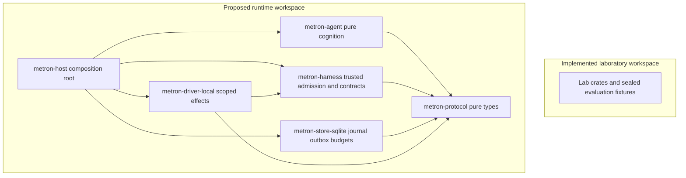

# Metron product-track development specification

> **Normative status:** This is a candidate design. Existing accepted ADRs, executable architecture tests, and measured laboratory results take precedence. No code or current experiment contract is changed by this proposal.

## Objective

Build two independently useful, all-first-party-Rust products:

- **metron-agent**: persistent *intelligence and reasoning*: identity, goals, role, persona, cognition, evidence-backed memory, deliberate action selection, delegated work and experimental adaptation. A default harness is bundled at the distribution/composition layer, not copied into the agent core.
- **metron-harness**: bounded *execution and computer use*: model interaction, context transport, typed tools, workspace/terminal access, computer-use adapters, budgets, sandboxing, receipts, authorization, verification and replay.
- **metron-protocol** (internal library): versioned commands, events and contracts with no effects. This is distinct from the **existing** research-lab `metron-core` and shall not be silently renamed to it.

Neither product may require the other at the library boundary. The distribution of `metron-agent` may embed the harness through an adapter; `metron-harness` must run independently.

## The actual question

Can a pure decision engine, a capability-bounded effect runtime and independently verified outcomes support **different cognitive strategies** with less ambiguity and safer adaptation than a conventional integrated model/tool loop?

The initial answer is unproven. The alpha program must test it rather than manufacture confirmation.

## Current repository compatibility: a hard gate

This repository is currently a **Hexagonal Cognitive Kernel research laboratory**, not a blank agent framework. Read `AGENTS.md`, `docs/architecture/{overview,invariants,milestones}.md` and ADRs 0007, 0008, 0009, 0012, 0014 before touching it. The current laboratory enforces:

1. `metron-core` pure and dependency-limited; sibling lab crates depend only on the core, composed through `metron-cli`.
2. Laboratory-only ground truth; the evaluated system cannot inspect fixtures, private criteria or verdicts.
3. External operations produce receipted, replayable evidence; deterministic hashes do not include wall-clock readings.
4. Representation changes require validated `TransformContract` provenance.

ADR 0009 additionally forbids direct model API clients **inside the current laboratory**; consultations use a checkpointed Claude Code file bridge. The proposed product's future model adapters are **not authorization to alter that accepted decision**. A separate new ADR, explicit boundary tests and a migration plan are required first.

**Proposed incubation:** a separate Cargo workspace under `products/runtime/` after review, rather than inserting experimental runtime dependencies into the current lab. The existing laboratory workspace membership, dependency boundaries, `metron-core`, `metron-cli`, `metron-lab` and experiment behavior are preserved. P0 verifies nested Cargo workspace discovery and records any required manifest-only exclusion explicitly. Future integration may exchange versioned observations and receipts through a reviewed bridge. Separate repositories remain an alternative if the root architecture tests cannot accommodate this without dilution.

## Non-negotiable principles

1. **Sans-IO cognition**: `step(&State, Event) -> Transition` has no fs/net/process/time/random/DB/model access. Determinism requires explicit inputs for seed, time and policy version.
2. **Authority is not personality**: personas, roles, prompts, skills and model text never grant capabilities.
3. **Capabilities are monotone downward**: a delegated task can receive only a subset of the parent authority, bounded by host policy.
4. **Effect receipts before claims**: record intended effects and outcomes; never infer success from a model assertion or process exit alone.
5. **Uncertain external effects are reconciled**: a crash after issuing an irreversible operation produces Unknown, not a blind retry or an exactly-once promise.
6. **Independent evaluation**: holdout criteria, private fixtures and promotion decisions are inaccessible to the candidate.
7. **Evidence trumps eloquence**: an observed result can revise a belief; a belief or tool narrative cannot invent an observation.
8. **Extension surfaces are bounded**: native traits for trusted built-ins; process/Wasm for untrusted code when supported; no plugin can override the authorization kernel.
9. **Licensing scope is explicit**: first-party source under Apache-2.0, dependencies and model weights audited separately. The default local LFM3 profile uses the custom LFM Open License v1.0; do not label that entire deployment FOSS. See [R-0008](../research/R-0008-local-inference-resource-profile.md) for exact artifacts and license sources.
10. **Measure before optimizing**: reject premature self-referential SQLite pointers, lock-free custom pointer caches and opaque multi-agent swarms.

## Proposed component and authority boundaries

The isolated workspace is the selected working proposal for implementation
planning. P0 writes a new compatibility ADR and proves dependency/evaluation
boundaries before runtime effects are introduced. All knowledge here remains
agent-authored and unratified. Contributors can implement and review P0 through
the normal integration workflow. Explicit human ratification of these records
is asynchronous and does not add a second implementation approval gate.

## Documentation contract

Read in order:

1. [R-0001 source audit](../research/R-0001-agent-harness-landscape.md) — primary-source landscape, what to borrow and what not to copy.
2. [R-0002 grammar](../research/R-0002-runtime-grammar.md) — ontology, well-formedness rules, logic pipeline, competing architectures.
3. [R-0003 agent](../research/R-0003-agent-contracts.md) — cognition, identity, role/persona, memory and delegation.
4. [R-0004 harness](../research/R-0004-harness-contracts.md) — computer use, execution, security, receipts, verification.
5. [R-0005 storage and extensions](../research/R-0005-storage-plugins-protocols.md) — Sans-IO boundaries, plugins, SQLite/GraphLite, external interfaces.
6. [D-0003 implementation sequence](D-0003-runtime-implementation-sequence.md) — ordered alpha release slices with objective exit gates.
7. [R-0006 Rust contracts](../research/R-0006-rust-implementation-contracts.md) — canonical crate layout and Rust-shaped normative code templates.
8. [R-0007 evaluation](../research/R-0007-runtime-evaluation.md) — assumptions ledger, falsification, red-team and budgeted adaptation experiments.

These documents specify intended **behavior and tests**, not a license to implement every listed interface in alpha 0.

## Decision posture

**Proposed first executable alpha**: one identity, one role, one persona, one cognitive strategy, one bounded harness, scripted model/tool backends, an event journal, a small safe workspace capability and an independent verifier. No distributed swarms, no GraphLite dependency, no Wasm extension loader, no real unrestricted desktop control and no self-promotion.

**Later alphas** extend in separate silos and are rejected or closed if their measured benefits do not justify complexity.

## Implementation handoff

Before coding, author an ADR that reconciles the proposed `products/runtime` workspace with existing architecture tests, ADR 0009 and the laboratory bridge. Any spec defect is fixed as a proposal revision. Accepted ADRs are **superseded**, never rewritten. Pull-request approval and test results, not document style, control adoption.

The language and formatting of this document deliberately resemble the desired API, source files, errors and tests. That may reduce ambiguity for a coding agent; it is **not** evidence that token-level resemblance guarantees correct implementations. Compiler, architecture and adversarial tests remain authoritative.

## Provenance and relations

- derived-from [original 00-charter.md](https://github.com/kmosoti/Metron/blob/4c3781daa7211efd39bcdb95dcb15491be1abe39/docs/proposals/metron-runtime/00-charter.md)
- indexed-by [runtime research and sequence](../research/README.md)
- reviewed-against [original proposal findings](../observations/O-0001-runtime-proposal-review.md)

## Revisit when

Implementation evidence, a changed workload, a source revision or a failed acceptance
criterion contradicts the proposed contract. Record the new evidence and update
linked decisions before expanding scope.
