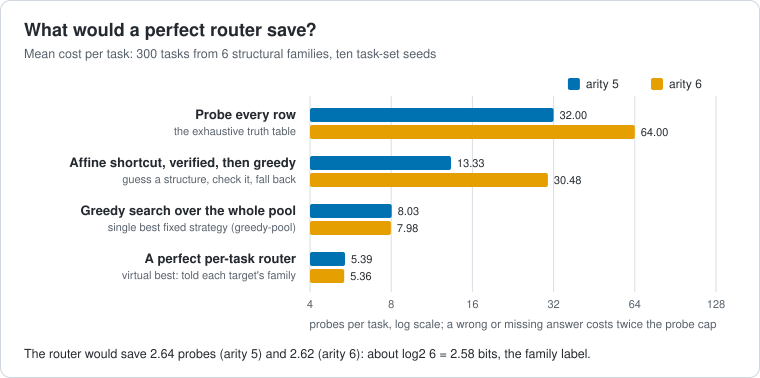
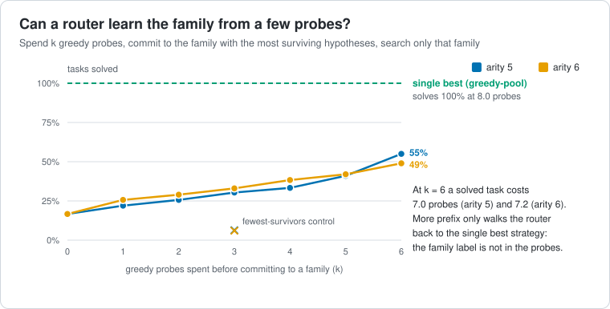
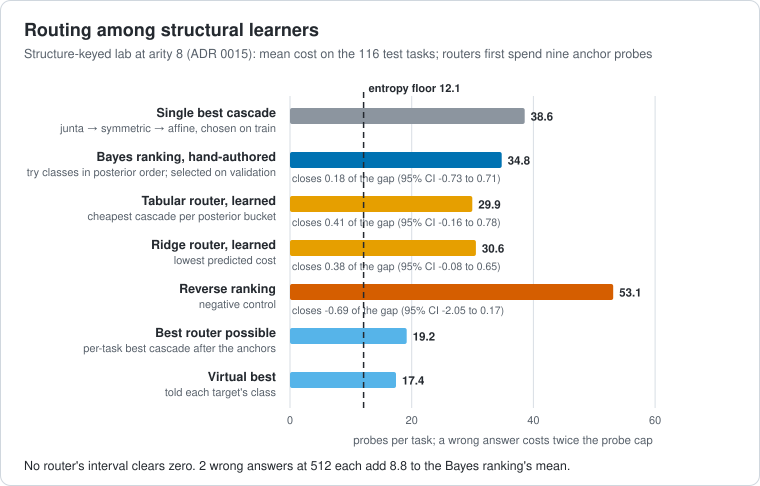
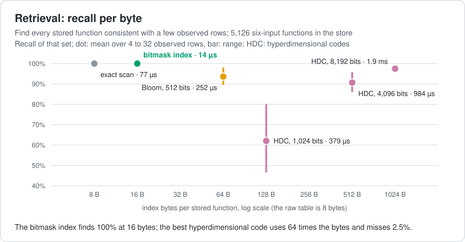
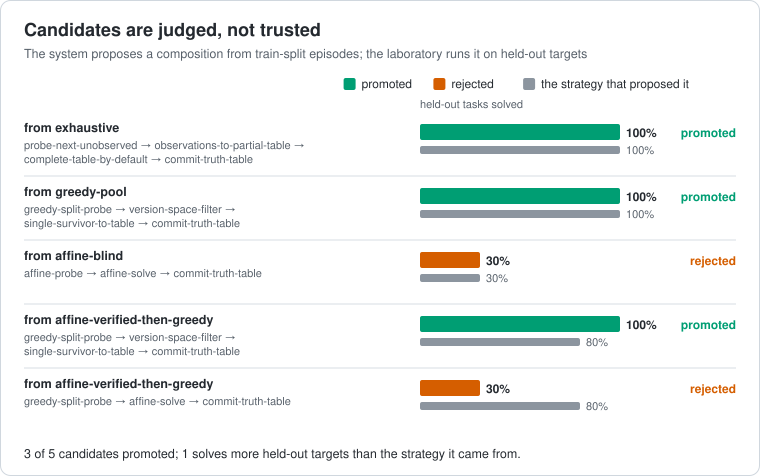
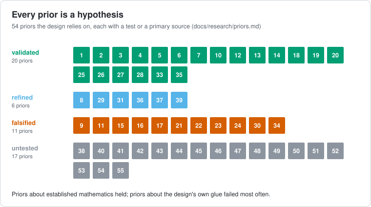
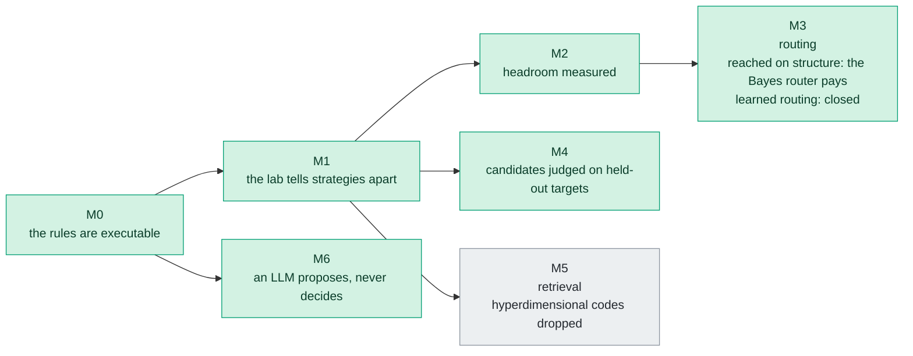

# Laboratory results and milestone snapshot

## Source and scope

This record preserves the laboratory findings and milestone summary from the
[main README at 0170c22](https://github.com/kmosoti/Metron/blob/0170c22c7e8de92cc73740f4e34a7bb25f2d4980/README.md).
The findings apply to the Boolean-function laboratories and workloads described
below. Product runtime work has its own proposal and release criteria.

The text and milestone diagram capture that source revision. The linked figures
continue to be generated from committed reports and the priors ledger, with
freshness checked by the architecture suite. The source revision retains the
original figure versions for historical comparison.

## What the laboratory has found

**A perfect router would save probes.** Six structural families, ten
task-set seeds. A clairvoyant per-task router beats the best fixed strategy
by about log2 6 probes: exactly the information in the family label. It
sits below the entropy floor, so no router that has to find the label for
itself could get there.

**But the label it routes on is not in the probes.** A real router has to
learn the family from the same probes it is trying to save. It cannot: more
prefix only walks it back to the single best strategy.

**Where the structure is in the function, routing pays.** In a
laboratory with no published pool, each class (affine, symmetric,
three-variable juntas) is learned by its own representation. A router
spends sixteen structural probes, ranks the classes by posterior, and
tries them in that order. On unseen tasks it closes about half the gap
and beats the best fixed order given the same probes. That took three
pre-registered runs, and learned routers never beat the hand-written
Bayes rule.

**Exact beats hyperdimensional for these objects.** Retrieving every stored
function consistent with a few observed rows, the bitmask index is complete,
smallest and fastest.

**The system proposes; the laboratory decides.** Compositions extracted from
episodes are judged on held-out targets, never on the episodes that produced
them.

**Every prior is a hypothesis.** Whatever the design relies on, whether
recalled, cited or derived, carries a test or a primary source.

These pictures are drawn from the committed reports by `metron figures`, and
the test suite fails if a report changes without its picture.

## Where it stands

Milestones are outcomes with exit criteria, never dates. A milestone closed
by a negative result is a result.

## Relations

- supported-by [committed experiment reports](../../experiments/reports/README.md)
- explained-by [architecture decisions](../../docs/adr/README.md)
- contextualized-by [scientific priors](../../docs/research/priors.md)
- tracked-by [laboratory milestone criteria](../../docs/architecture/milestones.md)
- linked-from [project overview](../../README.md)

## Revisit when

New measurements or accepted decisions change a laboratory conclusion. Record
new evidence with its workload and source revision, and link it to this snapshot.
