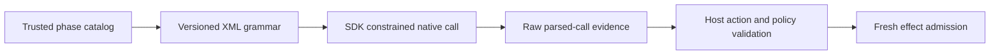

# Native XML coding constraints

The pinned SDK accepts a request-level Lark constraint alongside native tool
metadata. The explicit recognizer takes precedence over the SDK's automatic
tool grammar; the SDK tool parser still returns the call. Recipe v6 generates
that complete grammar solely from the admitted tool catalog. Its supported
catalog is limited to plan, edit, read, run and finish; other tools fail before
sampling. Unique required parameters and their permitted orders are represented
by bounded states. Host action validation, policy and admission remain
independent checks.

The LFM3 template places a framing newline before each parameter close. A CPU
probe with the corrected tokenizer showed that an earlier grammar without that
newline rejected a standard edit immediately after its path. The corrected
grammar accepts both template framing and compact calls. That mismatch is a
credible explanation for a prior edit-request timeout, but the SDK did not
expose partial generated XML, so the timeout's cause is not established.

With the fixed LFM3 Q4 artifact on the RTX 3060, an edit-only diagnostic using
the native SDK and corrected grammar returned one parsed, domain-valid edit for
a new Cargo manifest in 30.6 seconds. Its returned content parsed as a
Rust-2024 manifest without dependencies. It executed no tool and is not an
application acceptance result. The SDK did not expose the pre-parser bytes, so
byte fidelity across parsing was not measured.

The parser strips one framing newline from each raw value, coerces a bare
`null` to JSON null even for string parameters, and recognizes XML closing tags
within the generated stream. These constraints mean arbitrary file contents are
not guaranteed lossless. Grammar controls reject the tested absolute paths,
invalid digest, wrong plan element types, repeated or missing fields and
excluded tools; the host remains authoritative for other path rules, UTF-8 byte
bounds and integer overflow.

**Relations:** refines O-0010; does not complete the native task or resource
qualification gates in D-0005.
