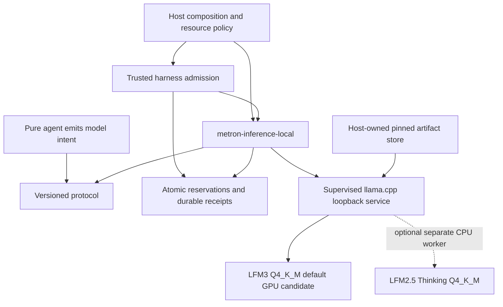

# Local inference plugin and resource profile

The default local model is **LFM3-1.7B Q4_K_M**. Evaluate
**LFM2.5-1.2B-Thinking Q4_K_M** as an optional CPU reasoning route. Minimize
Metron's idle footprint and measure total resource use before enabling a second
resident model. The plugin and settings below are implementation contracts;
the product runtime and live inference adapter do not exist yet.

## Sources and artifact identities

Audited on 2026-11-10 using official model cards, repository metadata and bounded
GGUF header reads. GB means 10^9 bytes; GiB means 2^30 bytes.

| Official artifact | Repository revision | Bytes | GB | GiB | Published SHA-256 |
| --- | --- | ---: | ---: | ---: | --- |
| [LFM3-1.7B-Q4_K_M.gguf](https://huggingface.co/LiquidAI/LFM3-1.7B-GGUF/tree/cd0c74c575b5c416f3011b5b4c298077f26ca8c2) | `cd0c74c575b5c416f3011b5b4c298077f26ca8c2` | 1,099,627,808 | 1.100 | 1.024 | `3793e1e6e2266919d6e015287221b41100175a98eddaba92e111aed3b05c93c4` |
| [LFM2.5-1.2B-Thinking-Q4_K_M.gguf](https://huggingface.co/LiquidAI/LFM2.5-1.2B-Thinking-GGUF/tree/b71945805f7d4d87dabd73e26098d44bcad6c35f) | `b71945805f7d4d87dabd73e26098d44bcad6c35f` | 730,899,072 | 0.731 | 0.681 | `4a1e1824f71091f368137b6966094461019f6af3a5aadd96033bee59fc9eaeea` |

Combined file size is 1,830,526,880 bytes: **1.831 GB / 1.705 GiB**.
These are downloadable artifact sizes, not measured VRAM or process working sets.
Tensor placement, repacking and metadata change resident weight allocations.
The hashes above are published LFS identities; full files have not been
downloaded and independently hashed in this audit.

The [LFM3 model card](https://huggingface.co/LiquidAI/LFM3-1.7B/blob/1da06bec6a819da10b54c67e5c90972b46d81871/README.md)
describes tool calling and structured outputs but discourages agentic coding and
complex multistep reasoning. The
[Thinking model card](https://huggingface.co/LiquidAI/LFM2.5-1.2B-Thinking/blob/fa4681e33c27d2861d1eacc9d29ccb68840344a0/README.md)
also discourages programming and knowledge-intensive tasks. Neither is a proven
coding backend for Metron. Its coding acceptance gate still requires independent
task verification; model size or upstream benchmarks cannot satisfy that gate.

Both checkpoints use **LFM Open License v1.0**, a custom license with commercial
conditions. Inspect each pinned repository's `LICENSE` and preserve required
notices before distribution. Metron-owned source remains Apache-2.0. This
default weight profile does not support an unqualified entirely-FOSS deployment
claim. [LFM3 license](https://huggingface.co/LiquidAI/LFM3-1.7B/blob/1da06bec6a819da10b54c67e5c90972b46d81871/LICENSE),
[Thinking license](https://huggingface.co/LiquidAI/LFM2.5-1.2B-Thinking/blob/fa4681e33c27d2861d1eacc9d29ccb68840344a0/LICENSE).

## Memory claims and deductions

There is **no established 2,048-token OOM threshold**. Total device memory includes
resident tensors, attention caches, convolution state, compute/work buffers,
CUDA context and allocator overhead. Batch size, parallel slots, cache dtype,
backend build and placement all matter. Q4_K_M quantizes weights; it does not
automatically make the KV cache 4-bit.

Subtracting the combined *file sizes* from 2 GiB leaves 302.27 MiB; subtracting
from decimal 2 GB leaves 169.47 MB. Neither remainder is a usable cache allowance
without measuring the other allocations and actual resident weights.

For a single sequence with FP16 keys and values, an attention-only estimate is:

```text
KV bytes = sum over attention layers(
    retained_tokens * KV_heads * (key_head_dim + value_head_dim) * 2 bytes
)
```

The pinned [LFM3 configuration](https://huggingface.co/LiquidAI/LFM3-1.7B/blob/1da06bec6a819da10b54c67e5c90972b46d81871/config.json)
and GGUF header contain six global-attention layers, five sliding-attention
layers, four KV heads, 128-dimensional heads and a 256-token sliding window.
The pinned [Thinking configuration](https://huggingface.co/LiquidAI/LFM2.5-1.2B-Thinking/blob/fa4681e33c27d2861d1eacc9d29ccb68840344a0/config.json)
and header contain six attention layers, eight KV heads and 64-dimensional heads
(`2048 / 32`). At **2,048 tokens per model**, full-window attention allocation
would be 44 MiB and 24 MiB respectively: 68 MiB combined. Ideal bounded sliding
retention lowers the first estimate to 26.5 MiB, or 50.5 MiB combined.
These calculations exclude padding, convolution state and every other runtime
allocation. They establish neither safety at 2,048 nor failure above it.

The Thinking card advertises a 32,768-token context while its pinned native
configuration and GGUF header encode 128,000. Do not infer validated long-context
quality or allocate that maximum by default. Use the explicit small profile
below; resolve this upstream discrepancy before raising the supported limit.

Read actual device capacity, free VRAM and Linux `MemAvailable` at admission.
A 2 GiB Metron device budget is distinct from physical GPU capacity. System RAM
is neither reserved CPU-model capacity nor automatically additional dedicated
VRAM. An assumed 18 GB of shared memory cannot establish current headroom.

## Proposed plugin boundary

Introduce `products/runtime/crates/metron-inference-local` in alpha.1, after P0
and alpha.0. It implements the harness model effect port and is wired directly
by `metron-host`. Alpha.3 can register the same trusted implementation through
its static registry. No inference dependency enters the agent or laboratory.



The first backend candidate is MIT-licensed llama.cpp `v0.8.0`, commit
`8642541b255bfb5dc39cd351a178be09013a55d6`; the
[official LFM3 GGUF instructions](https://huggingface.co/LiquidAI/LFM3-1.7B-GGUF/blob/cd0c74c575b5c416f3011b5b4c298077f26ca8c2/README.md)
require at least `b11960` / `v0.8.0`. Pin the tested binary/build identity during
implementation. Source inspection does not establish local backend compatibility.

The [pinned server reference](https://github.com/ggml-org/llama.cpp/blob/8642541b255bfb5dc39cd351a178be09013a55d6/tools/server/README.md)
documents explicit context, parallelism, CPU/device placement, cache types and
RAM prompt-cache limits. Map the profile to checked arguments. In particular,
disable RAM prompt-cache retention (`--cache-ram 0`), set one slot explicitly,
and prevent a CPU worker from automatically offloading tensors, KV or operations.
The backend's default cache allowance is a maximum, not an idle allocation.

## Initial resource policy

These are conservative starting settings to profile, not measured optima:

- LFM3 is the default local route. Thinking is opt-in and loaded only when that
  route is requested. Do not launch or retain two workers automatically.
- Start workers on demand and release them when their task finishes. Keep a
  worker for a task's multi-turn loop; do not reload weights for every turn.
  A configurable warm-residency policy requires an explicit memory/latency tradeoff.
- Admit at most one inference request across workers by default. Bound waiting
  requests, CPU threads, deadlines, context, generated tokens and response bytes.
  Start each worker at 2,048 total context tokens and at most 512 generated tokens;
  count system/template/tools/input and output reservation within that context.
  This is a configuration choice, not a hardware limit.
- Profile a **2 GiB aggregate Metron VRAM target**, with measured host-RAM
  headroom and a reserve for other processes. Compare GPU LFM3 plus CPU Thinking
  against each single-model profile. Dual-GPU residency remains an experiment.
- Use explicit FP16 KV initially. Any cache quantization, larger context,
  concurrency or warm secondary worker requires fresh quality and peak-memory
  evidence. Keep prefill microbatches bounded and record them in the profile.
- Check admission estimates against current free memory. Refuse a request when
  its profiled envelope does not fit; an explicitly configured CPU route may be
  used with the same accounting. Do not silently pull another model or use a
  hosted fallback. Record actual placement and any selected fallback.

A budget target and telemetry do not constitute a hard CUDA allocation cap.
Do not advertise a strict 2 GiB guarantee unless the selected backend provides
enforcement across all device allocations. If that guarantee is requested and
unsupported, reject that configuration explicitly. Physical OOM can still occur
after admission when another process consumes the remaining memory.

The suggested asymmetric placement is feasible in principle and avoids keeping
Thinking's weights/cache in VRAM. Keeping its worker warm still consumes host
RAM, CPU capacity and energy; superiority in latency or total resources is an
untested hypothesis. Models propose tool calls; the harness authorizes and
executes them independently.

## Effect and replay contract

Install weights explicitly, independently of inference requests; verify the full
artifact against its published digest before first use. Bind supervised workers
to loopback and fixed model identities. Use typed process arguments and bounded
HTTP payloads. Models cannot select executable paths or widen endpoint access.

Follow the existing persisted intent, admission, reservation, dispatch and
settlement lifecycle. Receipts identify model revision/hash, quantization,
backend/build, tokenizer/chat-template identity, sampling, cache/placement,
context/output bounds, usage, finish/truncation reason and resource observations.
Unknown usage remains explicit; local inference is not free resource usage.
Cancellation, backend loss and malformed replies produce typed outcomes and
preserve uncertainty/accounting. Replay consumes recorded model observations;
it does not regenerate them or assume seeded GPU inference is reproducible.

## Implementation acceptance and measurement

1. Run both model profiles against the same frozen task inputs, tool schemas and
   independent acceptance tests using each model's native template. Include the
   coding fixture, structured calls, malformed output, cancellation and overflow.
2. Compare LFM3-only GPU, Thinking-only CPU and asymmetric lazy/warm profiles.
   Test dual-GPU residency only as an additional budget-constrained experiment.
   Separate loading, cold prefill, warm prefill and decode timings. Do not infer
   workstation performance from vendor benchmark hardware.
3. Record artifact/build identities, GPU/CPU/RAM, actual placement, cache dtype,
   thread count, batch/microbatch, slots, prompt/output lengths and sampling.
   Report host-only overhead separately from backend RSS/PSS and device memory;
   account for shared/mapped pages and include transient prefill allocations.
4. Measure contexts 512, 2,048 and 4,096 with output reservation included; attempt
   larger contexts only inside the admitted envelope. Establish actual memory
   high-water marks with backend allocation reporting where available and device
   telemetry. A sampled memory reading alone is not a hard-limit proof.
5. Prove one-request admission across workers, bounded queues/caches/threads,
   zero GPU allocations for the forced-CPU profile, worker release after a task,
   and typed resource denial/backend failure with no silent fallback.
6. Demonstrate offline inference after installation, exact model binding,
   durable usage/overrun receipts, cancellation/restart reconciliation and replay
   from recorded responses. Publish evidence or close the candidate negative.

Only artifact metadata, header contents and arithmetic were checked here; no
model inference, OOM experiment, task-quality or latency benchmark was run.
Read the official API metadata with `?blobs=true` at each pinned model revision;
request `Range: bytes=0-65535` from the immutable GGUF resolve URL and inspect
the GGUF v3 metadata. The audit read 64 KiB per file, not the complete weights.

Relations: **implements** the model-adapter plan in
[D-0003](../decisions/D-0003-runtime-implementation-sequence.md);
**constrains** [R-0005 plugins and licenses](R-0005-storage-plugins-protocols.md)
and [R-0006 crate boundaries](R-0006-rust-implementation-contracts.md);
**registers** untested resource/quality priors in the
[canonical ledger](../../docs/research/priors.md).

Revisit when the backend/artifacts change, measured memory exceeds admission
estimates, task quality fails, supported hardware changes, or a matched benchmark
shows another placement/residency policy uses fewer resources at acceptable quality.
