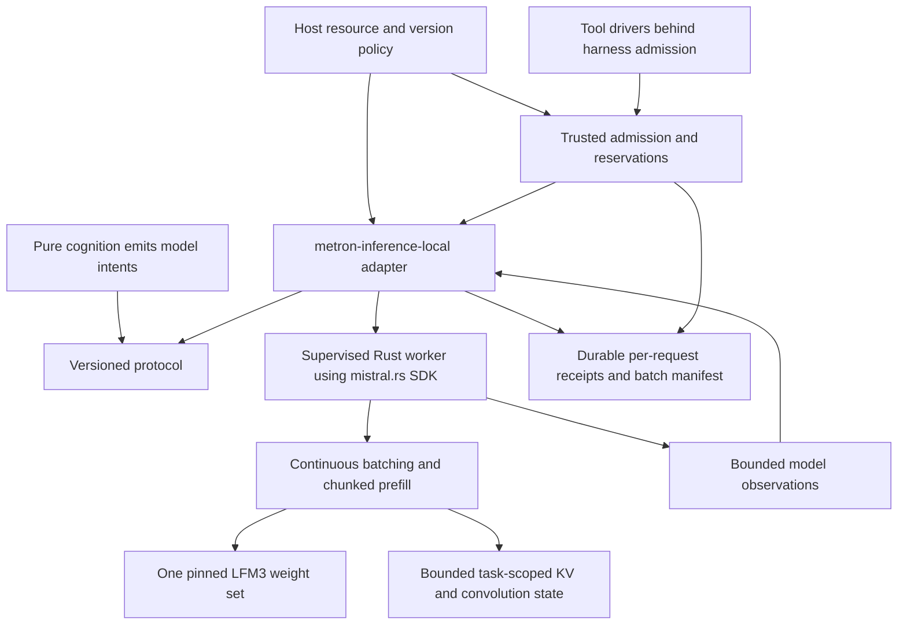

# mistral.rs inference, batching and cache contracts

Use **mistral.rs** for the proposed local inference plugin. Use the pinned
**LFM3-1.7B** checkpoint for both planning and tool-selection roles, sharing one
loaded weight set. LFM2.5 Thinking is excluded from the product profile. Select
additional LFM3 modality models only when a feature needs them and its budget
and quality gates pass; do not preload the family.

This contract extends [R-0008's artifact and memory audit](R-0008-local-inference-resource-profile.md).
The product workspace, inference plugin and performance optimizations remain
implementation work after P0 and alpha.0.

## Verified source identities and limits

Audited on 2026-11-10:

| Input | Pin and evidence | Status |
| --- | --- | --- |
| mistral.rs source | [`fb4cdc3730dc64b366724e7637a205a8b7747499`](https://github.com/EricLBuehler/mistral.rs/tree/fb4cdc3730dc64b366724e7637a205a8b7747499) | Inspected source snapshot; workspace manifest version `0.10.0`, Rust minimum `1.95`, MIT license. No local build or inference run. |
| Latest published release | [`v0.9.5`, `465191d0b0a7e2432d327b0de06204ab3f94d3a2`](https://github.com/EricLBuehler/mistral.rs/releases/tag/v0.9.5) | Published before LFM3; its source tree contains no LFM3 implementation. Do not assume a crates.io `0.9.5` dependency provides the inspected support. |
| Selected text model | `LiquidAI/LFM3-1.7B`, revision `1da06bec6a819da10b54c67e5c90972b46d81871`; Q4_K_M GGUF revision/hash in R-0008 | Current official instruction-tuned LFM3 text checkpoint at audit. Exact artifact installation and backend compatibility remain acceptance work. |

The [official LFM3 collection](https://huggingface.co/collections/LiquidAI/lfm3)
lists text, vision, audio, omni and decision models. No separate official
LFM3 Thinking text checkpoint was found in that collection or the audited
LiquidAI model listing. A planning role on LFM3 is not evidence of a distinct
reasoning model or of improved coding quality.

The pinned [model-family notes](https://github.com/EricLBuehler/mistral.rs/blob/fb4cdc3730dc64b366724e7637a205a8b7747499/docs/src/content/docs/guides/models/model-family-notes.mdx#lfm3-and-lfm3-vl)
document LFM3 text/VL CPU, CUDA and Metal execution and GGUF loading. The native
[LFM3 loader](https://github.com/EricLBuehler/mistral.rs/blob/fb4cdc3730dc64b366724e7637a205a8b7747499/mistralrs-core/src/pipeline/loaders/lfm3.rs)
advertises paged attention; the
[model implementation](https://github.com/EricLBuehler/mistral.rs/blob/fb4cdc3730dc64b366724e7637a205a8b7747499/mistralrs-core/src/models/lfm3.rs)
has hybrid attention/convolution state and packed prefill. These are source
facts, not proof that every quantization/device/kernel combination works.

Choose the newest qualifying LFM3/backend revisions during a version update,
then freeze model, tokenizer/template, quantization, runtime commit, Cargo.lock,
compiler and binary identities. Never resolve floating `latest`, `master` or
model `main` during a task. Requalify an update against the same acceptance suite.

## Composition and authority

The integration has an adapter crate and a worker binary crate. Only the worker links
the selected mistral.rs backend and accesses model artifacts/device APIs.
Use bounded typed IPC and process supervision to isolate backend failure from
the harness. Keep automatic model downloads disabled after explicit installation.
The laboratory and pure agent gain no model or process dependencies.

mistral.rs also offers an agentic runtime and tool loop. Use its inference
facilities only: register no backend tool executors, MCP servers, shell/code
tools, web search or independent session-memory authority. Return proposed
tool calls to Metron; the harness performs its normal authorization and effects.
Verify this boundary with a model-output attack fixture. Backend functionality
is not a reason to delegate Metron's policy or journal to another agent loop.

## Adaptive batching within resource bounds

Use mistral.rs's existing scheduler. Its pinned
[architecture reference](https://github.com/EricLBuehler/mistral.rs/blob/fb4cdc3730dc64b366724e7637a205a8b7747499/docs/src/content/docs/developer/architecture.md)
describes continuous batching of requests sharing a model engine. The host's
job is bounded admission, fairness and accounting, rather than a second token
scheduler.

1. Admit compatible requests to the same weight/device/quantization pipeline.
   Preserve each request's task, principal, prompt, limits, sampler and result
   identity. Never concatenate independent conversations into one prompt.
2. Select active-sequence and total-token ceilings from a measured memory
   profile and current headroom. Use one sequence as the baseline; qualify
   two and four before admitting larger batches. Override the server's default
   concurrency explicitly. Reduce concurrency under memory pressure; do not
   deliberately fill VRAM to maximize batch size.
3. Dispatch interactive work immediately. Fill remaining capacity from queued
   compatible work as slots open; never wait indefinitely to assemble a batch.
   Bound queue length and wait time, honor cancellation/deadlines, and prevent a
   long prefill or bulk task from starving interactive decode.
4. Use chunked prefill with an explicit per-step token ceiling. Measure the
   prefill/decode balance and padding waste on mixed prompt lengths. Enable the
   feature only for the validated LFM3 format/device path.
5. Each logical request still needs persisted intent and independent grant,
   lease and budget admission before dispatch. Link batch membership and shared
   resource observations to separate request receipts. A batch cannot borrow a
   task's unused output budget or hide missing usage behind an aggregate total.
6. One request's cancellation or failure must not misroute another response,
   release its reservation or destroy its state. If a worker dies, mark affected
   dispatched requests uncertain and reconcile them before redispatch.

## Cache, memory and loading policy

The pinned [paged-attention guide](https://github.com/EricLBuehler/mistral.rs/blob/fb4cdc3730dc64b366724e7637a205a8b7747499/docs/src/content/docs/guides/perf/paged-attention.mdx)
describes shared KV blocks, prefix reuse, explicit cache goals and an aggregate
GPU utilization goal. CPU execution uses regular per-request caches. An explicit
KV-byte goal limits the cache, not the whole process; include weights, convolution
state, working buffers, graph capture and allocator overhead in Metron's budget.
Do not give a 2 GiB KV pool to a worker with a 2 GiB total device target.
For the CPU route, omit GPU paged-cache goals and bound its regular caches
through explicit sequence/context limits and measured host-RAM headroom.

- Start with the pre-quantized GGUF in R-0008. Benchmark load-time peaks before
  selecting native ISQ/UQFF; their quantization and temporary allocations are
  not established by the GGUF's file size.
- Configure cache blocks, retained-prefix owners, host cache/spill and maximum
  sequence length explicitly. Bound both bytes and retained-entry counts, use
  eviction, and release caches/workers after their task. Avoid automatic use of
  all remaining VRAM or an unbounded RAM cache.
- Reuse exact authorized prefixes within a task. Cache identity includes model,
  template/tokenizer, adapter/configuration, exact token prefix and applicable
  authority/context version. Restore **both attention and convolution state**;
  a KV-only prefix hit is insufficient for this hybrid model.
- Prevent cross-scope reuse: require a verified namespace boundary, or flush/
  disable prefix reuse when authority scope changes. Do not assume the backend
  has a namespace API. If safe bounded reuse is unavailable, recompute the prefix.
- Keep context assembly incremental and bounded: use stable tool schemas and
  relevant source excerpts, avoid resending duplicated file/tool content, and
  report truncation. Any summarization call has its own admission and receipt.
- Profile supported FlashAttention/FlashInfer and CUDA-graph paths on the actual
  device. Record capture/workspace peaks as well as speed. Quantized KV is a
  separate quality experiment; weight quantization does not imply cache dtype.
- Keep one weight set resident during an active task. Additional role prompts
  do not create another model instance. CPU fallback uses the same pinned LFM3
  artifact through an explicitly qualified route; release unused GPU state.

The 2 GiB aggregate VRAM target remains a measured admission envelope. A memory
planner or sampled telemetry alone does not prove an enforced hard allocation
cap. Strict-cap requests require supported enforcement or explicit rejection.

## Acceptance and decision criteria

Run normal Metron receipt/replay/cancellation tests plus:

| Property | Discriminating check |
| --- | --- |
| Actual backend/format compatibility | Load the pinned LFM3 GGUF offline in the pinned mistral.rs build; run CPU and selected GPU paths and report actual kernels/placement. |
| Useful batching | Compare one, two and four active sequences on identical frozen short/long/mixed request sets, same artifacts and acceptance tasks; measure completed accepted tasks, p50/p95 wait/first-token/finish latency, prefill/decode throughput and total peak resources. |
| Correct hybrid state | Compare isolated uncached requests against batched, chunked and prefix-reused requests, using declared numerical tolerances and independent task acceptance. Include prefix edits, different-length decode, cache eviction/reload and cancellation/reordering of batch members. |
| Bounded memory | Measure weights, attention/convolution state, retained prefixes, load/prefill/capture transients, host RSS/PSS and host-only overhead. Verify queue/token/cache limits and resource denial without assuming an OOM context threshold. |
| Scope isolation | Try matching token prefixes across different principals/grants/context versions; prove no unauthorized state or response reuse. Disable/flush reuse if the backend cannot enforce the required partition. |
| Per-request accounting | Race final-unit reservations while requests batch; settle/cancel one without changing another's receipt, budget or result identity. Record unavailable shared-cost attribution explicitly. |
| Authority boundary | Emit forged tool calls and backend-agent instructions; no model/worker output executes a tool without normal harness admission. |
| Update reproducibility | Verify complete artifact/build identities, reject mismatched profiles, and replay recorded responses without resampling. |

Freeze workload, quality criteria, hardware and latency target before tuning.
Compare optimization-off and optimization-on runs at matched quality and
resource limits; include cold/warm loading and cache hit/miss cases. Retain only
settings with demonstrated benefit. Do not turn upstream support statements
into a Metron speed, memory or quality claim.

Relations: **implements** alpha.1 in
[D-0003](../decisions/D-0003-runtime-implementation-sequence.md);
**extends** [R-0008](R-0008-local-inference-resource-profile.md);
**constrains** [R-0006](R-0006-rust-implementation-contracts.md);
**registers** untested batching/cache benefits in
[priors](../../docs/research/priors.md).

Revisit on a new qualifying LFM3/runtime revision, failed correctness/isolation
test, measured budget overrun or evidence that a simpler resource profile meets
the same accepted-work and latency targets at lower cost.

### Qualification observation: scheduler and visibility

At the pinned source revision, LFM3's [forward path](https://github.com/EricLBuehler/mistral.rs/blob/fb4cdc3730dc64b366724e7637a205a8b7747499/mistralrs-core/src/models/lfm3.rs#L1177-L1311) uses sequence-indexed recurrent slots alongside attention state. The lower-level [scheduler configuration](https://github.com/EricLBuehler/mistral.rs/blob/fb4cdc3730dc64b366724e7637a205a8b7747499/mistralrs-core/src/scheduler/mod.rs#L56-L65) exposes a prefill-chunk limit; the [prefix manager](https://github.com/EricLBuehler/mistral.rs/blob/fb4cdc3730dc64b366724e7637a205a8b7747499/mistralrs-core/src/prefix_cacher.rs#L520-L535) can associate recurrent checkpoints with block-hash keys. Those keys do not themselves encode a Metron principal or task. Metron's worker binds requests to a task and principal, but currently rejects chunked prefill and scoped prefix caching and disables prefix caching. That binding alone is not evidence that SDK cache reuse is scope-isolated.

Qualification records can report dispatch-began to the first received nonempty non-reasoning output frame, with the number of scored cases for which it was observed. This is a host visibility boundary: transport or SDK buffering can delay it, and an absent frame is unknown. It is not first generated token latency. The existing completion latency starts at the host Sent callback; if that callback is absent or follows frame receipt, the completion latency is unknown rather than zero. Fixed-model batching, chunking, cache isolation, hybrid-state equivalence and resource behavior still require the controlled qualification described above; this observation does not complete that work.

The opt-in `paged-chunk-prefill-v1` worker experiment requires CUDA, disabled
prefix reuse and a nonzero KV planning target of at most 256 MiB. It retains
the realized paged cache configuration and limits prefill chunks to at most
256 tokens and scheduler batches to at most 512 tokens; smaller realized limits
remain smaller. The target is a KV planning input, not a hard VRAM or process
memory cap. A missing paged scheduler is rejected. This plumbing is
unqualified: actual chunk execution, model equivalence, resource use and
cancellation with concurrent requests still require fixed-model tests.

## Numerical diagnostic limits at the pinned revision

Source inspection at `fb4cdc3730dc64b366724e7637a205a8b7747499` rules out using
`send_raw_chat_request` to qualify batching, chunked prefill or prefix reuse.
Raw-logit requests bypass prefix lookup, disable chunking and are scheduled as
singletons; their returned tensors cover prompt positions rather than a normal
chat decode. Equality on that route would not test the production mechanisms.
See [raw prefix bypass](https://github.com/EricLBuehler/mistral.rs/blob/fb4cdc3730dc64b366724e7637a205a8b7747499/mistralrs-core/src/engine/add_request.rs#L978)
and [raw-request scheduling](https://github.com/EricLBuehler/mistral.rs/blob/fb4cdc3730dc64b366724e7637a205a8b7747499/mistralrs-core/src/scheduler.rs#L298).

Normal chat can retain selected-token and top-alternative log probabilities.
That offers a partial numerical discriminator when token histories align and at
least two finite alternatives remain. Grammar rejection can change which masked
or unmasked distribution is reported, and that branch is not exposed. Set the
top-alternative count after selecting the deterministic sampler. Single forced
tokens, missing values and divergent histories are inconclusive. See the
[pinned request path](https://github.com/EricLBuehler/mistral.rs/blob/fb4cdc3730dc64b366724e7637a205a8b7747499/mistralrs/src/model.rs)
and [sampler](https://github.com/EricLBuehler/mistral.rs/blob/fb4cdc3730dc64b366724e7637a205a8b7747499/mistralrs-core/src/sampler.rs).

This is a source-derived diagnostic option, not executed numerical evidence or
full state equivalence. Log probabilities disable some device sampling fast
paths, so their timings cannot qualify production performance. Any comparison
still needs proof that batching, chunking or a cache hit actually occurred, plus
separate semantic acceptance with production settings.
