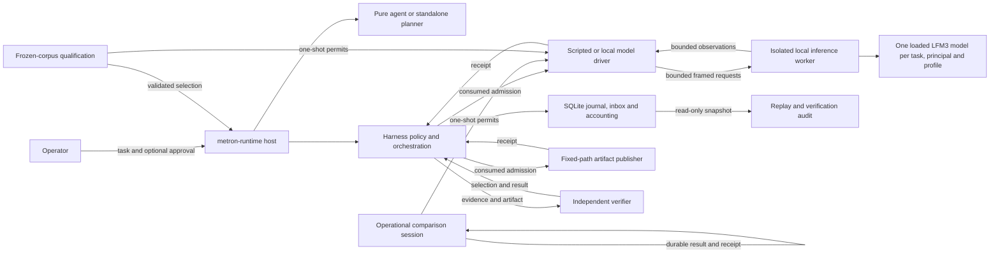

# Metron runtime alpha.0

The runtime is a separate Rust workspace for one bounded, scripted task. It reads
`fixture://sum-v1/input`, asks the scripted `sum-v1` model for a candidate, writes
one result artifact and independently verifies the result. Its default scripted run
does not use a live model, shell, network, or workspace tools. An optional local
inference worker is available for model effects and operational comparisons. The run directory is a trusted local
directory on a filesystem that supports durable file sync and hard links.



Cognition proposes intents; host policy and the SQLite admission transaction
control execution. SQLite retains receipts, accounting, and recovery state. An
admitted dispatch whose result is unknown is not repeated automatically.

## Build and run

The workspace pins its Rust toolchain in `rust-toolchain.toml`. From this directory,
use `cargo build -p metron-host` to build `metron-runtime`.

Local inference uses an explicitly installed, pinned model and its tokenizer,
template, configuration, and license files. Install either qualification artifact with
`metron-runtime model install --artifact control --cache-dir DIR` or replace
`control` with `challenger`. Installation requires `curl` with HTTPS support and
verifies the full bytes of each file. The model is stored at the cache root; the
auxiliary files are stored under `auxiliary/<pinned-revision>/`. Keep a
`tokenizer.json` out of the cache root so the worker uses the embedded GGUF
tokenizer. The cache may be used offline after installation.

Create a candidate configuration with `metron-runtime model candidate --artifact
control --device cpu --threads 2 --sequences 1 --worker /absolute/path/to/worker
--model-cache /absolute/path/to/cache --output candidate.json`. CUDA selection
uses `--device cuda:UUID`; the recorded device identity includes the actual UUID,
model, memory, and driver. Candidate creation verifies the installed bytes and
does not download anything.

To build the local worker, first run `cargo fetch --locked`, then run
`python3 tools/prepare-mistralrs-cache.py` from the repository root. Limit backend
builds to one job with debug information and incremental compilation disabled.
For manual CUDA builds also set `CUDAFORGE_THREADS=1`.

### Local worker and comparisons

The worker uses native mistral.rs at commit `fb4cdc3730dc64b366724e7637a205a8b7747499`; the published 0.9.5 release does not contain LFM3 support. CPU is the default build; CUDA is optional. After fetching dependencies and preparing the backend cache as above, a CUDA build from this workspace can use:

```sh
export CUDA_HOME=/path/to/cuda
export CUDA_ROOT="$CUDA_HOME" CUDA_PATH="$CUDA_HOME"
export PATH="$CUDA_HOME/bin:$PATH"
export LD_LIBRARY_PATH="$CUDA_HOME/lib64${LD_LIBRARY_PATH:+:$LD_LIBRARY_PATH}"
export CUDA_COMPUTE_CAP=86 CUDAFORGE_THREADS=1 CARGO_BUILD_JOBS=1
export CARGO_INCREMENTAL=0 CARGO_PROFILE_RELEASE_DEBUG=0
cargo build --release --locked --offline -p metron-inference-worker --features cuda
```

`86` targets compute capability 8.6; use the capability of the intended GPU. The compiler and toolkit must be compatible. Building CUDA kernels consumes host RAM; inference VRAM is a separate resource and a successful build does not establish a viable runtime memory envelope.

The operational comparison reads the official Q4_K_M, Q6_K and Q8_0 GGUF files from the cache root, pinned at `cd0c74c575b5c416f3011b5b4c298077f26ca8c2`, and verifies their full sizes and SHA-256 hashes before use. The exact pins are:

| GGUF file | Bytes | SHA-256 |
| --- | ---: | --- |
| `LFM3-1.7B-Q4_K_M.gguf` | 1,099,627,808 | `3793e1e6e2266919d6e015287221b41100175a98eddaba92e111aed3b05c93c4` |
| `LFM3-1.7B-Q6_K.gguf` | 1,427,638,304 | `54e1bd947c77167823d45bf495f1c3e2d226ca7fb242f83cfa141ee3a6ab55c6` |
| `LFM3-1.7B-Q8_0.gguf` | 1,846,238,496 | `8f6b24182258205e9e01e21f1f24a1f208c1e8115578825d202ce39976af20b6` |

The existing installer supplies `control` (Q4_K_M) and `challenger` (QAD-Q4_0); obtain Q6_K and Q8_0 separately from that pinned repository revision before an offline comparison. The auxiliary files remain under the pinned auxiliary revision. With a CUDA worker and a suitable GPU, run:

```sh
metron-runtime model compare --worker /absolute/path/to/metron-inference-worker \
  --artifacts /absolute/path/to/cache --output /absolute/path/to/results
```

Optional `--quant q4|q6|q8` and `--concurrency 1|2|4|8` restrict a run. Without filters the comparison covers all three quantizations and concurrency levels. A profile has one isolated worker and one loaded model shared by requests scoped to the same task, principal and profile. Reasoner returns text; ToolSelector returns a closed proposal, not authority to execute a tool. Reasoner latency is measured to usable streamed content; selector latency is measured to a valid final proposal. The baseline uses an 8,192-token context with output reserved, thinking disabled, and prefix cache, paged attention and CUDA graphs disabled.

Local requests permit up to 64 KiB of decoded context and a 512 KiB framed request. Replies remain bounded to 64 KiB and existing output and receipt limits still apply. Legacy task context remains limited to 4 KiB. Each comparison request has a durably admitted one-shot permit and its own identity and receipt. An uncertain outcome blocks its session and is not retried automatically. Session identifiers bind the canonical UTF-8 directory, profile, phase and frozen inputs; directory aliases share the same identity. Use a fresh session directory for an independent trial.

The fixed comparisons test short and near-8K inputs across three repetitions. An operational candidate must meet correctness, both roles' p95 usable-output latency below one second, a process GPU memory peak at most 4 GiB and at least 1 GiB free GPU memory; concurrency 1 is a baseline rather than a selectable candidate. There may be no acceptable candidate. The staggered case records whether the reasoner SDK stream is still awaiting its terminal response when the selector reaches the worker; actual backend batch membership remains unknown. These results do not automatically promote a profile: production selection retains the separate frozen-corpus qualification gate. See [ADR 0021](../../docs/adr/0021-local-inference.md) and [R-0010](../../knowledge/research/R-0010-lfm3-native-inference.md).

A minimal task file is:

```json
{"schema_version":1,"task_id":"example","principal_id":"operator","objective":"Sum the fixture values","budget":{"max_model_requests":1,"max_tool_calls":2,"max_spend_micros_usd":0,"max_elapsed_ms":null},"max_decision_steps":8}
```

```sh
cargo run -p metron-host -- run --task-family sum-v1 --task task.json --run-dir run-1
cargo run -p metron-host -- replay run-1
cargo run -p metron-host -- verify run-1
```

`run` requires an empty run directory. Use `--mode harness` for the standalone
planner; the default is `--mode agent`. Add `--require-publication-approval` to
require an operator decision before publishing. The immutable artifact path is
`artifacts/<intent-id>/<dispatch-id>/result.json` under the run directory.

New runs require explicit `--task-family sum-v1` selection. The task's objective
is descriptive; this legacy family verifies only the fixed sum fixture. Missing
or unsupported families reject before creating run state or loading a model.
Existing persisted runs can still resume, replay and verify without this flag.
Coding tasks remain unavailable until their tool and acceptance contracts land.

### Pinned tool inventory

`metron-runtime toolkit inspect CATALOG.json` checks operator-selected executable
hashes before fixed version probes and reports the linked SQLite/FTS5 capability.
On Linux, executable bytes are copied into a bounded sealed image and the
verified image is executed, so replacing the original file cannot substitute a
different executable. Interpreters and shared libraries remain operator-trusted
dependencies; this check does not qualify a full distribution or sandbox.
The report is inventory only; it cannot authorize tools or qualify a runtime
profile. Version output and process waits are bounded. Missing files, digest or
version mismatches and uncertain probes return a nonzero status.

A catalog has `schema_version: 1` and a `tools` array. Each entry contains `tool`
(`jj`, `ripgrep`, `z3`, `lean`, `cargo`, `rustc` or `bubblewrap`), an absolute
`executable`, its full `sha256`, and `version_prefix`. Use immutable trusted tool
paths rather than auto-installing shims. The catalog digest can be bound into a
coding-task contract; it is not a permission set.

The public [admission models](contracts/README.md) provide positive/negative SMT
and Lean checks for development. Runtime adapters for these tools remain gated
on confinement and admission. [D-0005](../../knowledge/decisions/D-0005-alpha1-delivery.md)
tracks alpha.1's implementation and release evidence.

If a run is blocked, `resume RUN` processes durable work without polling or
advancing time. Its `pending_intent` field identifies the current intent.
`reconcile RUN --intent ID` inspects a previously dispatched
publication and records its outcome if the file matches the persisted plan;
reconciliation does not drive cognition. Multiple distinct evidence records for a
single dispatch, Unknown usage, and conflicting evidence remain unresolved for
operator investigation; reconciliation does not replace them with inferred costs.
To advance the logical clock explicitly,
pass all three options to either command: `--advance-tick T --expected-tick E
--command-id C`. A lease or approval expires against that clock, not wall time.

For an approval request shown in a command report, record the bound decision with:

```sh
metron-runtime approval RUN --request-id ID --action-digest DIGEST --decision approve --command-id COMMAND
```

Use `deny` to reject the request. Recording a decision does not dispatch an effect;
run `resume` separately. Replay and verify open the existing database read-only.
Verify additionally examines the artifact. Every command writes a versioned JSON
report to stdout; diagnostics may also appear on stderr. The report distinguishes
command success from verified task success and exposes current health, accounting
and audit results. Exit codes are 0 for a successful command, 1 for semantic rejection, 2 for
invalid input, 3 for policy or budget denial, 4 for blocked or uncertain work, 5
for an integrity failure, and 6 for an operational failure.

An alpha.0 audit supports up to 4,096 journal records and 8 MiB of cumulative
canonical journal bytes. An audit above either limit returns operational exit 6;
the history remains intact and the report does not assert an audit result.
