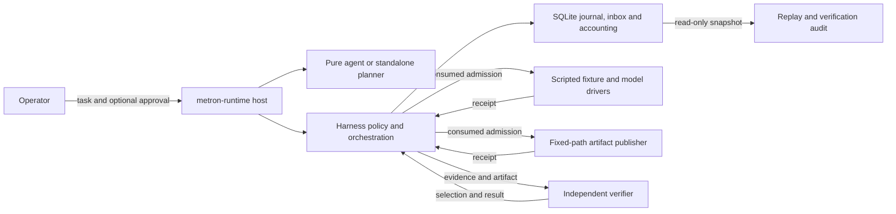

# Metron runtime alpha.0

The runtime is a separate Rust workspace for one bounded, scripted task. It reads
`fixture://sum-v1/input`, asks the scripted `sum-v1` model for a candidate, writes
one result artifact and independently verifies the result. It does not use a live
model, shell, network, or workspace tools. The run directory is a trusted local
directory on a filesystem that supports durable file sync and hard links.



Cognition proposes intents; host policy and the SQLite admission transaction
control execution. SQLite retains receipts, accounting, and recovery state. An
admitted dispatch whose result is unknown is not repeated automatically.

## Build and run

The workspace pins its Rust toolchain in `rust-toolchain.toml`. From this directory,
use `cargo build -p metron-host` to build `metron-runtime`. A minimal task file is:

```json
{"schema_version":1,"task_id":"example","principal_id":"operator","objective":"Sum the fixture values","budget":{"max_model_requests":1,"max_tool_calls":2,"max_spend_micros_usd":0,"max_elapsed_ms":null},"max_decision_steps":8}
```

```sh
cargo run -p metron-host -- run --task task.json --run-dir run-1
cargo run -p metron-host -- replay run-1
cargo run -p metron-host -- verify run-1
```

`run` requires an empty run directory. Use `--mode harness` for the standalone
planner; the default is `--mode agent`. Add `--require-publication-approval` to
require an operator decision before publishing. The immutable artifact path is
`artifacts/<intent-id>/<dispatch-id>/result.json` under the run directory.

If a run is blocked, `resume RUN` processes durable work without polling or
advancing time. Its `pending_intent` field identifies the current intent.
`reconcile RUN --intent ID` inspects a previously dispatched
publication and records its outcome if the file matches the persisted plan;
reconciliation does not drive cognition. Multiple distinct evidence records for a
single dispatch, Unknown usage, and conflicting evidence remain unresolved for
operator investigation; reconciliation does not replace them with inferred costs.
To advance the logical clock explicitly,
pass all three options to either command: `--advance-tick T --expected-tick E
--command-id C`. A lease or approval expires against that clock, not wall time.

For an approval request shown in a command report, record the bound decision with:

```sh
metron-runtime approval RUN --request-id ID --action-digest DIGEST --decision approve --command-id COMMAND
```

Use `deny` to reject the request. Recording a decision does not dispatch an effect;
run `resume` separately. Replay and verify open the existing database read-only.
Verify additionally examines the artifact. The JSON report distinguishes command
success from verified task success and exposes current health, accounting and audit
results. Exit codes are 0 for a successful command, 1 for semantic rejection, 2 for
invalid input, 3 for policy or budget denial, 4 for blocked or uncertain work, 5
for an integrity failure, and 6 for an operational failure.

An alpha.0 audit supports up to 4,096 journal records and 8 MiB of cumulative
canonical journal bytes. An audit above either limit returns operational exit 6;
the history remains intact and the report does not assert an audit result.
